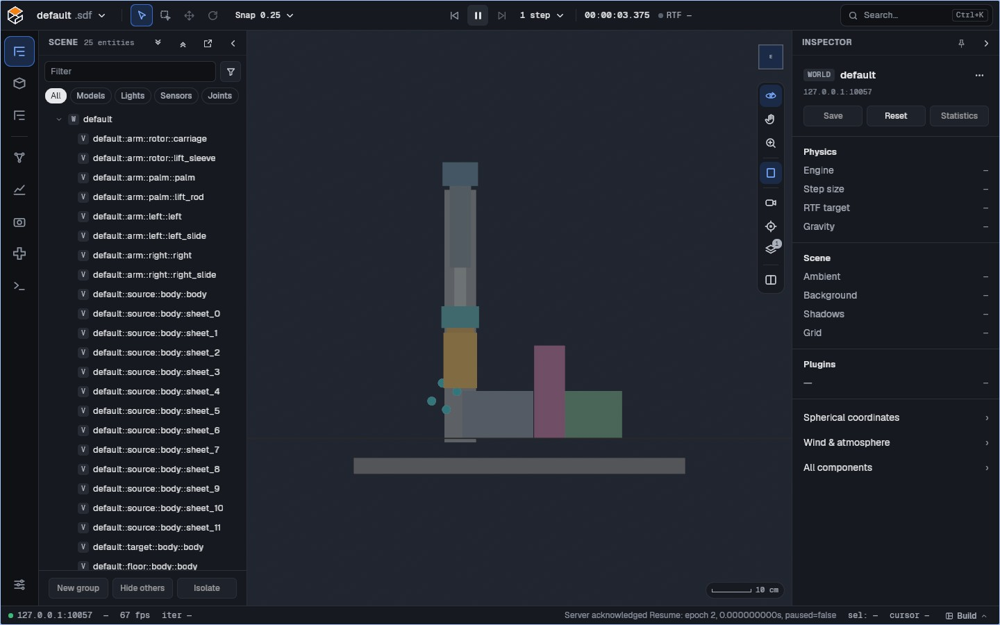
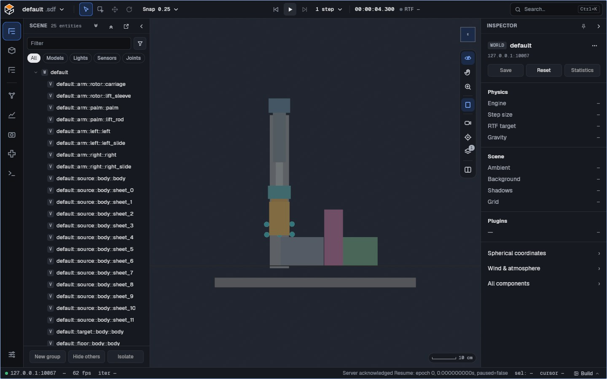

# Holding a sheet when the table load reaches its edge

The gripper can now require the table's measured load to act at least 2 mm inside every top-face edge before it opens. It placed the well-supported sheet and kept hold of overhangs that fell with pressure-only release. The rule uses the signed table force, moment, receiver geometry and measured receiver travel. The particle positions are recorded independently to check what happened. [Good placement](http://127.0.0.1:8082/?backend=primitive&ui=full&quality=low&replay=1&lifecycle=1&url=ws%3A%2F%2F127.0.0.1%3A10066%2F) · [Holding at the lip](http://127.0.0.1:8082/?backend=primitive&ui=full&quality=low&replay=1&lifecycle=1&url=ws%3A%2F%2F127.0.0.1%3A10067%2F) · [Missing receiver](http://127.0.0.1:8082/?backend=primitive&ui=full&quality=low&replay=1&lifecycle=1&url=ws%3A%2F%2F127.0.0.1%3A10070%2F)

| Pressure-only release, sheet tipping at 3.375 s | Margin check, sheet still pinched at 4.300 s |
|---|---|
|  |  |

## Results on the robot clock

The gripper lifted the same 8.4 g sheet, waited while the finite table moved sideways and lowered the sheet with 1 ms actuator feedback. The 16-, 64- and 250-exchange trials also used public 1 ms Bevy commits. The 1,000-exchange reference ran each 1 µs solve in a separate native Bevy commit and updated the controller at the same 1 ms times. A guarded test used the same initial conditions, material parameters and release pressure as its pressure-only partner. [Previous table-edge measurements](sheet-table-edge.md)

| Deck shift | Physics exchanges per ms | Pressure-only outcome | 2 mm margin outcome |
|---:|---|---|---|
| 80 mm | 16, 64, 250, 1,000 | Placed | Placed |
| 89 mm | 16, 250 | Placed | Held |
| 95 mm | 16, 64, 250, 1,000 | Fell | Held |
| 130 mm | 16, 64 | Held | Held |
| 130 mm | 250, 1,000 | Fell | Held |
| 165 mm | 16 | Held | Held |

At 80 mm the jaws first opened at 3.075, 3.088, 3.100 and 3.101 s for 16, 64, 250 and 1,000 exchanges respectively. All 4,300 actuator rows, including the complete particle-state digests, matched on that placement at each of the four rates. At 95 mm the guarded robot withheld the opening command on the exact tick when the pressure-only robot first tried it. At 16 exchanges, pressure alone passed on 1,267 post-lowering ticks when the resultant was outside the allowed margin. The comparison independently reconstructed the top-face intersection on each of the 64,500 measured controller ticks.

During the 95 mm overhang at 16 exchanges per millisecond, each finger still measured 0.825 N of squeeze at the end. The table carried 81.63 mN and the fingers 0.78 mN upwards on average over the last 100 ms. To test whether it was still a usable grasp, the physical regression continued from that live world with the jaws closed. It slid the table another 100 mm in 400 ms and waited 200 ms. The table cleared every particle skin by 41.12 mm. The fingers alone carried 82.4039 mN over the last 100 ms, compared with the sheet weight of 82.404 mN. The table reaction was zero.

The 89 mm offset illustrates the tradeoff close to the boundary. At 16 exchanges its center was 0.983 mm inside the edge when both fingers unloaded in the pressure-only run, and the sheet remained on the table. The 2 mm setting conservatively kept the fingers closed. The same placement and refusal occurred at 250 exchanges. The 165 mm control missed the receiver and kept holding through the 4 mm search limit.

## Receiver geometry and decision

The native solver reports the impulse on the receiver and its moment about the **collision center at the start of the interval**. Negating both gives the impulse on the payload, expressed about the same point. The controller rotates the vectors into the horizontal box's authored collision frame. For impulse **J**, moment **K** and the receiver's measured displacement **d**, the moment about its ending center is **K − d × J**. The top-plane intersection is `x = (h Jx − Ky) / Jz`, `y = (Kx + h Jy) / Jz`, where `h` is half the box height. The implementation evaluates both bounds without division and requires the resultant inside both the starting and ending footprints. A real SDF loading test checks the result with a yawed, off-center collision. The controller rejects tilted decks and invalid frames.

Twenty consecutive 1 ms samples must satisfy both the margin and the original 80–150% weight band. An edge reading resets that window and holds the jaw trajectory. Signed vertical force still drives the existing bounded lift search. A zero or downward normal cannot confirm release. The near-zero test supplied a centered upward impulse for two simulated seconds and verified that the robot kept the grip closed through the search limit.

The 2 mm setting was chosen for this deck using the previous measured placements. It describes the distance of the resultant from the deck edge. It cannot by itself predict whether an arbitrary deformable payload will eventually slip, roll or tear.

## Reproduce

```sh
RUSTC_WRAPPER= cargo run --locked --release --no-default-features -p gz-sim-cli \
  --example local_robot_foundations -- sheet-edge target/guarded-edge-95 \
  --deck-shift-mm 95 --exchanges 16 --release-margin-mm 2 --verify-reset
RUSTC_WRAPPER= cargo test --locked --release --no-default-features -p gz-sim-cli \
  --example local_robot_foundations margin_tests -- --nocapture
RUSTC_WRAPPER= cargo run --locked --release -p gz-sim-cli --bin gz-sim-rs -- \
  docs/measurements/local-manipulation/sheet-deck-margin-held-replay --server --replay --web-viewer 9002
```

Use a fresh output directory. Omit `--release-margin-mm` to reproduce pressure-only release. Each saved gz-web-rs capture independently checked 173 frames, 2,076 material positions, 4,325 body poses and shapes, and reset to time zero. [Full numeric receipt](sheet-deck-margin.json) · [Controller geometry](../../../crates/gz-sim-scene/src/grasp_guard/deck_margin.rs) · [Physical gripper and withdrawal regression](../../../crates/gz-sim-cli/examples/local_robot_foundations/sheet_setdown/margin_tests.rs)

Strict Clippy passed. Ten grasp-controller tests, three margin/physical regressions, six finite-edge tests and seven original placement tests passed. Against `b4b83b8`, changed production coverage reached 55/55 lines (100.00%), 85/85 regions (100.00%) in the scene crate and 64/65 lines (98.46%), 117/122 regions (95.90%) in the CLI. Each raw profile was matched to its own executable before exporting coverage. Three default-pressure replays, their 4,300-row wrench and trajectory traces, and their receipts remained byte-identical to the frozen phase.


The combined integration build at `9abd440` includes a correction for virtual interpolation points on compliant pads. All 26 pressure-only and guarded trials were repeated on that build, including six 4.3-million-step native references. Their 111,800 public samples, signed wrench and particle traces, SDF construction and native replay streams were byte-identical to the original measurements. The full table-withdrawal regression also reproduced the measured jaw load and clearance exactly. In this gripper the real-particle articulated boxes use the solver's oriented-collider path and its finite table has zero compliance.
