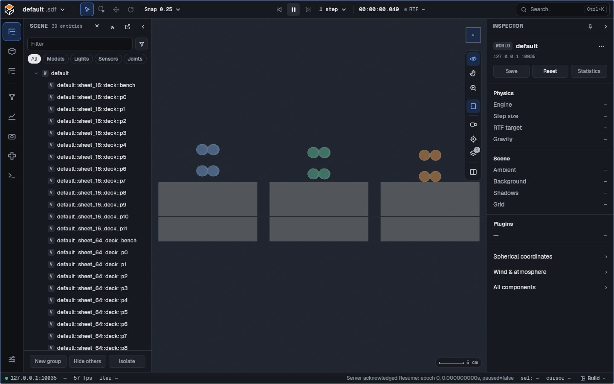

# The first compression sets the folded sheet’s rebound

The same sheet rebounded 1.262 mm at 16 material steps per millisecond and 11.362 mm at 4,000. Giving only the first millisecond a finer step preserved almost all the height obtained with that finer step throughout. The public gripper commands ran at their ordinary 1 ms cadence. [Watch the coarse, middle and fine sheets side by side](http://127.0.0.1:8082/?backend=primitive&ui=full&quality=low&replay=1&lifecycle=1&url=ws%3A%2F%2F127.0.0.1%3A10035%2F)



## Two physical incoming states

The finite bench dropped 50 mm once the fingers had unloaded. Each complete robot run supplied a committed material clone 500 µs after the bench stopped, before the first impulse. The cuts landed at simulation times 3.251500 s and 3.249500 s. Each clone retained particle positions and velocities, rest lengths, signed dihedral angles, material configuration and contact history. The stationary finite bench retained its actual dimensions, orientation and center. The robot exerted zero loaded pad impulses throughout the 80 ms comparison interval. Each isolated branch at its incoming rate reproduced all 81 sampled native particle frames and table impulses exactly. [Earlier physical withdrawal](sheet-receiver-drop.md) · [Model and independent checks](sheet-impact-rebound.json)

| Impact steps per ms | First peak from 16-step incoming, mm | First peak from 64-step incoming, mm |
|---:|---:|---:|
| 16 | 1.262 | 1.065 |
| 64 | 6.130 | 6.041 |
| 125 | 8.331 | 8.205 |
| 250 | 9.777 | 9.643 |
| 500 | 10.590 | 10.455 |
| 1,000 | 11.025 | 10.886 |
| 2,000 | 11.248 | 11.108 |
| 4,000 | 11.362 | 11.220 |

In each column only the material clock changed. Switching between the two incoming states at a fixed resolution changed the peak by at most 0.197 mm. Switching the impact resolution on one state reproduced the original several-millimetre discrepancy. The residual change from 2,000 to 4,000 steps was 0.113 mm.

## Impulse and energy

From the 16-step incoming state, the first millisecond gave the entire sheet 9.677 mN s of upward table impulse at 16 steps, 11.260 mN s at 64 and 12.305 mN s at 4,000. Its vertical center-of-mass kinetic energy at that instant rose from 0.103 to 0.499 to 0.924 mJ. Fine integration retained more energy during compression and produced greater upward momentum. Whole-interval table impulse closed against the change of vertical momentum and gravity within 10⁻¹⁰ N s. A single particle with the same total mass, incoming speed, skin height and receiving box settled at every tested resolution. The measured normal rebound therefore requires the sheet’s internal response.

Using 1,000 steps for the first millisecond and 16 for the remaining 79 ms yielded 11.011 mm. Reversing the schedule yielded 1.267 mm. Extending fine integration from one to four milliseconds changed the result by less than 0.001 mm. These switches were timed relative to the saved state. A practical refinement policy needs to identify the compression from body and receiver observations in the running world.

## Repeat

```sh
RUSTC_WRAPPER= cargo run --locked --release --no-default-features -p gz-sim-cli \
  --example local_robot_foundations -- sheet-rebound target/rebound-16 --incoming 16
RUSTC_WRAPPER= cargo run --locked --release --no-default-features -p gz-sim-cli \
  --example local_robot_foundations -- sheet-rebound target/rebound-64 --incoming 64
```

The native replay shows the 16, 64 and 4,000-step trajectories from left to right. It translates each copy sideways at the original physical scale. Each of its 81 displayed instants was checked against the three sets of 12 particle positions, with a timeline rewind to zero. [Rust benchmark](../../../crates/gz-sim-cli/examples/local_robot_foundations/sheet_setdown/rebound.rs)

The new CLI benchmark reached 342/351 changed production lines (97.44%) and 684/717 regions (95.40%). Including its tests, it reached 438/447 lines and 878/911 regions. Each profile matched the producing executable. Strict Clippy and all twelve targeted tests passed.
