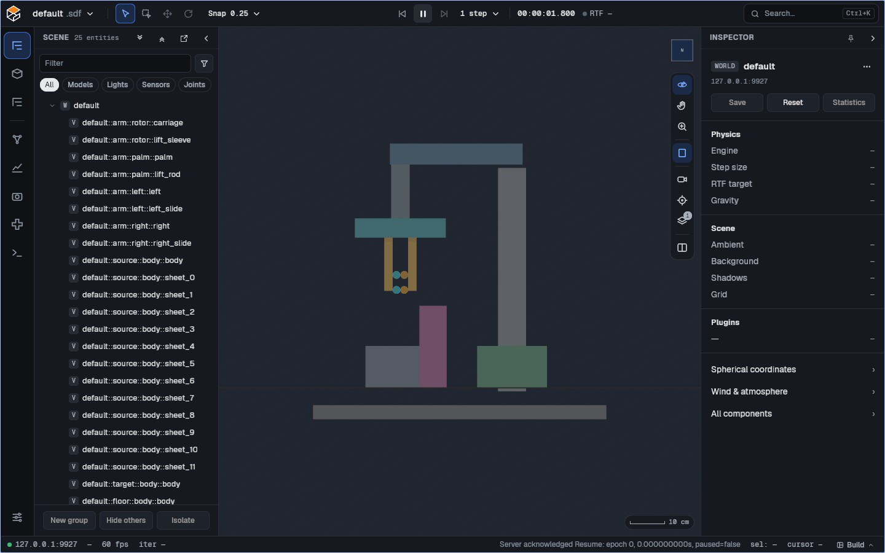

# How often a light gripper needs to exchange contact forces with a folded sheet

Two 2.8125 g jaws on the articulated SDF arm lifted an 8.4 g folded sheet about 150 mm. Both pads supported an equal share of its 0.082404 N weight once the coupled solution converged. The study measured each jaw separately because opposite errors can cancel in the total supported load. [All measured rates and signed loads](sheet-jaw-convergence.json)



The controller updated exactly 3,400 times in each completed 3.4 s run. Changing the native timestep changed how often Rapier and the material solver exchanged reactions between controller updates. The recorded cost is p95 of the sum of native physics step times in each 1 ms controller period. It excludes recording and controller computation. The pinned runs used one soft substep per native step at rates of four and above, two at rate two and four at rate one. The two finest rates were 16 and 32 exchanges per ms.

| Pad compliance (m/N) | Lowest tested rate qualifying against finer runs (per ms) | Largest recorded node error vs 32 (µm) | p95 physics time vs 32 (ms) |
|---|---:|---:|---:|
| 0.001 | 8 | 13.56 | 2.34 / 9.59 |
| 0.00025 | 8 | 13.08 | 2.26 / 10.10 |
| 0.0000625 | 16 | 22.98 | 5.12 / 9.61 |

The comparison uses all twelve nodes at 137 samples, a 0.1 mm position tolerance and a separate 1%-of-sheet-weight tolerance for each jaw's mean vertical force during the hold. Every finer measured run must pass both checks. At 0.00025 m/N, four exchanges produced only 17.2 µm of position error but missed a jaw force by approximately 0.0058 N. At 0.0000625 m/N, eight exchanges gave +0.22811 and −0.14571 N, with 1.652 mm of position error. Sixteen gave +0.04121 and +0.04120 N. [Eight exchanges in gz-web-rs](http://127.0.0.1:8082/?backend=primitive&ui=full&quality=low&replay=1&lifecycle=1&url=ws%3A%2F%2F127.0.0.1%3A9926%2F) · [Sixteen exchanges in gz-web-rs](http://127.0.0.1:8082/?backend=primitive&ui=full&quality=low&replay=1&lifecycle=1&url=ws%3A%2F%2F127.0.0.1%3A9927%2F)

In a separate controller comparison at 0.001 m/N with one exchange and two material substeps, the nominal 12 N·s/m jaw damping left the sheet on the bench. Scaling the derivative gain with the square root of jaw mass reduced it to 1.5 N·s/m and lifted the panels 149.619 and 149.620 mm. The same force and speed limits applied in both runs. The trajectory and individual force acceptance above require the finer clocks. Zero-compliance contact and lighter configurations remain outside this measured range. [Nominal damping](http://127.0.0.1:8082/?backend=primitive&ui=full&quality=low&replay=1&lifecycle=1&url=ws%3A%2F%2F127.0.0.1%3A9924%2F) · [Mass-scaled damping](http://127.0.0.1:8082/?backend=primitive&ui=full&quality=low&replay=1&lifecycle=1&url=ws%3A%2F%2F127.0.0.1%3A9925%2F)

The material solver now counts the local intervals it actually accepts on each branch of a retry. At the 737 ms sliding-sheet checkpoint the adaptive, coarse and fine settings used 196, 361 and 768 accepted intervals respectively. The previous deepest-level estimate overstated the work on unevenly divided intervals. [Sliding-sheet timing and checkpoint](fold-slide-refinement.md)

## Reproduce the stiffer-pad comparison

Run from the physics checkout. Use a fresh output directory for each study.

```sh
export RUSTC_WRAPPER=
export CARGO_TARGET_DIR="${CARGO_TARGET_DIR:-$PWD/target}"
cargo build --locked --release -p gz-sim-cli --no-default-features --example local_robot_foundations
sim="$CARGO_TARGET_DIR/release/examples/local_robot_foundations"
out=artifacts/reproduce-stiff-jaws
for rate in 1 2 4 8 16 32; do
    case "$rate" in 1) soft=4 ;; 2) soft=2 ;; *) soft=1 ;; esac
    "$sim" sheet-jaws "$out/$rate" --jaw-mass-scale 0.015625 --tune-damping \
        --pad-compliance 0.0000625 --exchanges-per-ms "$rate" --substeps "$soft"
done
"$sim" sheet-jaw-convergence "$out"/{1,2,4,8,16,32}
```

A refused native solve records its tick and solver diagnostic. A completed run records the native clock, actuator count, particle positions, signed reactions and native replay. Each of the two stiffer-pad recordings shown above passed the independent replay geometry check and browser comparison of 3,425 poses and shapes, including rewind.

The recording comparator also rejects incompatible authored scenes, clocks, initial particle positions, incomplete simulations and duplicate rates. On revision 218de7b its four release tests passed and it independently reproduced all three selections from the physical recordings. Runs against damaged and incomplete records exercised its error paths. Across the comparator change LLVM covered 126/126 production lines and 249/254 regions (98.03%).
