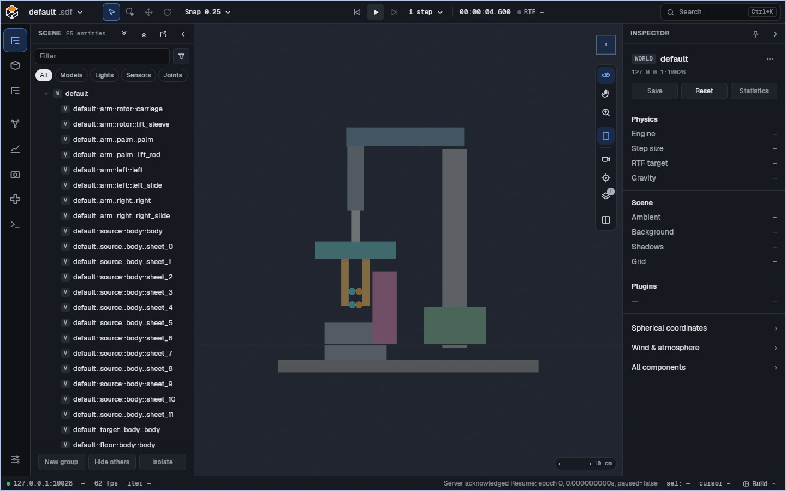
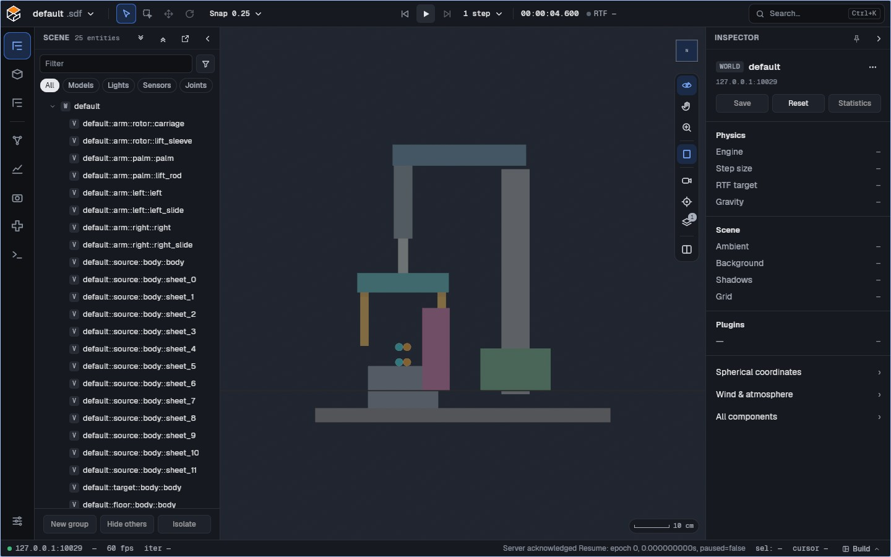

# Withdrawing the receiver during jaw opening

The bench dropped 50 mm after eight milliseconds of opening. Both fingers still touched the folded sheet, and the robot paused their opening on its next 1 ms command. The sheet remained suspended 46.96 mm above the lowered bench. At 40 ms of opening the pads were already unloaded. The same motion then let the sheet fall for 101 ms before hitting the bench. [Watch the retained sheet](http://127.0.0.1:8082/?backend=primitive&ui=full&quality=low&replay=1&lifecycle=1&url=ws%3A%2F%2F127.0.0.1%3A10028%2F) · [Watch the late withdrawal](http://127.0.0.1:8082/?backend=primitive&ui=full&quality=low&replay=1&lifecycle=1&url=ws%3A%2F%2F127.0.0.1%3A10029%2F)

| Early withdrawal, sheet still held | Late withdrawal, sheet landed |
|---|---|
|  |  |

## Forces and timing

The robot picked up the same 8.4 g folded sheet in the ordinary Rust SDF/Bevy world. The 200 × 180 mm finite receiver moved straight down at 0.5 m/s for 100 ms. The bench motion began only after the requested amount of jaw opening had actually been commanded. The gripper controller read the actual table reaction from the preceding actuator tick. Each physical step advanced rigid bodies, material and table together. Commands stayed fixed for each full millisecond.

| Receiver and exchanges per ms | First downward motion | Opening pauses | Result |
|---|---:|---:|---|
| Stationary, 16 | — | — | Placed with zero unsupported intervals |
| Early, 16 | 3.120 s | 3.121 s | Both fingers stayed loaded and the 4 mm search stopped at 4.301 s |
| Early, 64 | 3.118 s | 3.119 s | Both fingers stayed loaded and the search stopped at 4.299 s |
| Late, 16 | 3.152 s | 3.153 s | First returning load at 3.252 s, opening finished at 3.624 s |
| Late, 64 | 3.150 s | 3.151 s | First returning load at 3.250 s, opening finished at 3.877 s |

Times in the table denote the end of the corresponding committed tick. For both late trials the interval from the start of deck motion to the end of the first returning load tick was 101 ms. The early trials finished with 1.617 N of combined squeeze, 82.42 mN of upward finger force and zero receiver reaction, compared with the 82.404 mN weight. The opening ramp stopped at 9 ms out of 350. The stationary control reopened fully with the sheet supported by the bench. The finite receiver currently requires separate native Bevy exchanges, so the two tested configurations used 62.5 µs and 15.625 µs physics steps with one actuator update each millisecond.

## Independent flight check

A payload falling from rest above a receiver moving down at speed *v* opens a gap of *vt − gt²/2* while the deck moves. With gravity 9.81 m/s² the peak gap is 12.742 mm. After the deck stops, the first return takes √(2 × 0.05 / 9.81) = 100.96 ms from the start of the drop. The measured peak was 12.726 mm at 16 exchanges per ms and 12.737 mm at 64. Across all 100 sampled instants before the first return, the largest trajectory errors were 0.031 mm and 0.010 mm respectively.

The post-impact motion remains sensitive to step size. With the two rates the sheet accumulated 137.31 ms and 236.23 ms without pad or table contact through the end of the run, including the initial fall and intermittent separation after hitting the bench. The maximum gap after first impact reached 1.26 mm and 6.04 mm respectively. Integrated table and finger impulse minus gravity closed within 1.8 × 10⁻¹¹ N s from initial support to final rest at both rates. Both runs eventually supported the full weight on the deck. Pausing jaw opening can retain a sheet that is still pinched. Once the sheet is free, it needs another physical support or a different recovery maneuver.

## Reproduce

Each run takes a fresh output directory. Both 16-exchange disturbances repeated all 4,600 measurements exactly after an ordinary world reset. The regression also compares every actuator row against the stationary trial prior to each disturbance, including the complete material-state digest. The two live WebGPU replays each checked 185 frames, 2,220 particle positions and 4,625 primitive poses and shapes. [Native physical regression](../../../crates/gz-sim-cli/examples/local_robot_foundations/sheet_setdown/tests.rs) · [Measured data and executable identities](sheet-receiver-drop.json)

```sh
RUSTC_WRAPPER= cargo run --locked --release --no-default-features -p gz-sim-cli \
  --example local_robot_foundations -- sheet-setdown target/drop-early \
  --mode drop-early --exchanges 16 --native-steps --verify-reset
RUSTC_WRAPPER= cargo run --locked --release --no-default-features -p gz-sim-cli \
  --example local_robot_foundations -- sheet-setdown target/drop-late \
  --mode drop-late --exchanges 16 --native-steps --verify-reset
```

To serve either saved recording on another port, use the normal Rust replay server.

```sh
RUSTC_WRAPPER= cargo run --locked --release -p gz-sim-cli --bin gz-sim-rs -- \
  docs/measurements/local-manipulation/sheet-receiver-drop-early-replay \
  --server --replay --web-viewer 9002
```

Changed `gz-sim-cli` example code covered 86/87 (98.85%) mapped lines and 168/173 (97.11%) regions. Including the physical and admission tests, coverage was 129/130 (99.23%) and 294/304 (96.71%). Each raw LLVM profile matched its own executable build ID. Strict Clippy and all seven targeted integration tests passed.
