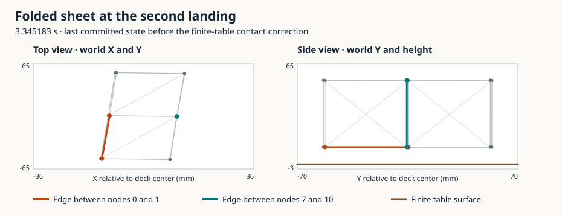

# The folded sheet’s second landing

The fine-step robot now completes the full 4.6 s transfer and leaves the sheet’s 82.404 mN weight on the table. The saved contact cut also rejoins the cold robot run at 3.346 s with all 72 particle position and velocity components byte-identical after 817 additional steps. The full recording was verified in gz-web-rs over 261 frames, including 3,132 independently checked particle positions and 6,525 primitive poses and shapes. [Watch the complete transfer](http://127.0.0.1:8082/?backend=primitive&ui=full&quality=low&replay=1&lifecycle=1&url=ws%3A%2F%2F127.0.0.1%3A10046%2F) · [Portable transfer recording](sheet-recontact-replay/manifest.json)

The robot’s 1 µs reference ran from pickup through its first rebound. At 3.345183 s the finite table changed the velocity of the settling sheet and left two material edges moving toward each other at 2.135 mm/s. The solver refused the next step six times as it increased resolution from 1 to 32 subdivisions. The last committed particle state and the actual two jaw and table inputs now reproduce this one microsecond directly in a Rust regression. [Restart fixture](../../../crates/gz-physics-xpbd/tests/fixtures/released_sheet_3345183.rs) · [Regression and independent geometry](../../../crates/gz-physics-xpbd/tests/released_sheet_cut.rs)



The contact-detail replay shows the measured particles, both prescribed jaw pads and the finite receiver immediately before and after the recovered microsecond. Orange and teal identify the four nodes on the active edges. A WebGPU replay check verified 24 particle positions and 30 body poses and shapes over both frames. [Inspect the saved contact in gz-web-rs](http://127.0.0.1:8082/?backend=primitive&ui=full&quality=low&replay=1&lifecycle=1&url=ws%3A%2F%2F127.0.0.1%3A10053%2F) · [Portable contact-detail recording](sheet-recontact-detail/manifest.json)

## What the geometry shows

Independent Parry queries found no intersection in any of the 29 disjoint triangle pairs in the committed sheet. For the proposed step, edges 0–1 and 7–10 reached their combined 22 mm skin thickness. Across the entire sweep their centerlines stayed at least 21.99999999687 mm apart. This lower bound combines 65,537 independent segment-distance evaluations with a bound on relative endpoint displacement between evaluations. At the end of the trial their centerlines were within 5 femtometres of 22 mm, with a closing speed of 2.135 mm/s.

When the original solver exhausts its subdivisions, it can now reconcile both endpoint velocities on a single finite support. Every particle and its skin must remain inside one flat face, all material contacts with the support must share its normal, and the scene must contain one fixed-or-translating box and the prescribed jaws. The solver applies the additional compressive and frictional impulses to the actual table, rechecks the material sweep and publishes on success. A clipped deck and an additional receiver both preserve the original refusal and incoming state.

| Restarted 1 µs step | 1 material interval | 8 material intervals |
|---|---:|---:|
| Upward table impulse | 9.439 µN s | 9.303 µN s |
| Linear momentum residual | 2.97 × 10⁻¹⁹ N s | 2.15 × 10⁻¹⁹ N s |
| Angular momentum residual | 1.03 × 10⁻¹² N m s | 1.23 × 10⁻¹³ N m s |
| Change in mechanical energy | −0.263 µJ | −0.223 µJ |

Across 1, 2, 4 and 8 material intervals, both jaws reported zero impulse. Shell and table friction stayed within their respective Coulomb limits. Every particle ended within 0.1 µm of its independently stepped eight-interval position.

## Robot controls

The original continuous 1 µs robot had already completed the first rebound before the later refusal. It reached 10.996225 mm and delivered 12.249067 mN s during the first millisecond of the matched observation window. Selective material refinement on the 62.5 µs rigid clock reached 11.014396 mm and 12.246118 mN s. From identical incoming states the continuous fine-material comparison reached 11.028687 mm. Those two continuously fine cases start from different pickup histories. [Earlier release, impulse and timing controls](sheet-adaptive-landing.md)

The corrected fine robot reached the same first rebound and first-millisecond impulse as the original. Its jaws finished opening at 3.841 s. On this shared Ryzen 9 9950X3D the run took 831 s of measured native-step time, with a p95 of 234 ms per 1 ms actuator interval.

Five full robot reruns reproduced every public observation from the earlier solver byte for byte. These were adaptive normal placement and early withdrawal, plus coarse, selective and continuous-fine-from-the-cut late withdrawal. The complete actuator histories cover 22,700 public milliseconds.

## Reproduce the saved contact

```sh
RUSTC_WRAPPER= cargo test --locked --release -p gz-physics-xpbd \
  --test released_sheet_cut -- --nocapture
```

The full robot runs through the regular SDF, Bevy and local solver path with one millisecond between actuator updates.

```sh
RUSTC_WRAPPER= cargo run --locked --release --no-default-features -p gz-sim-cli \
  --example local_robot_foundations -- sheet-impact-clock target/fine-sheet-release \
  --mode drop-late --clock fine-native --landing-step-ns 1000
```

All 240 active material crate tests passed with all features. The separately invoked long-running shell timing regression also passed. Strict all-target Clippy passed. Changed production coverage reached 101/102 lines and 184/187 regions. [Measurements and exact build IDs](sheet-recontact.json)
