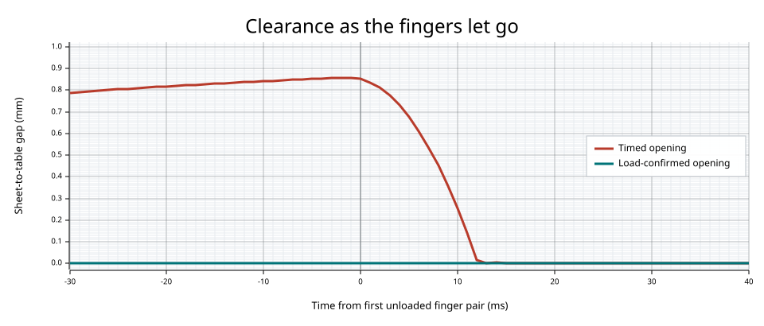
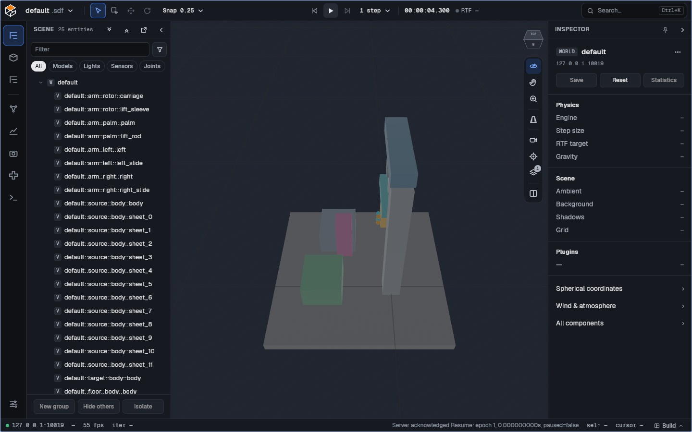

# The gripper opens after the table carries the sheet

With the timed release, the folded sheet was still about 0.85 mm above the table when the fingers let go. The new controller waits for measured support and lowers the wrist another 1.12 mm. At 16 native exchanges per millisecond the timed run accumulated 15.81 ms without either finger or table support after opening began. The load-confirmed run had zero such measured intervals. [Load-confirmed placement](http://127.0.0.1:8082/?backend=primitive&ui=full&quality=low&replay=1&lifecycle=1&url=ws%3A%2F%2F127.0.0.1%3A10017%2F) · [Timed opening](http://127.0.0.1:8082/?backend=primitive&ui=full&quality=low&replay=1&lifecycle=1&url=ws%3A%2F%2F127.0.0.1%3A10018%2F)



The orange and blue spheres mark the two panels of one 8.4 g cloth mesh. Its known weight is 82.404 mN. During nominal lowering the sheet touches the table while the jaws still pinch it. In the 16-exchange reference, the 50 ms ending at 2.550 s delivered 34.19 mN s of upward table impulse and reached a 1.493 N one-millisecond mean. The gripper begins checking for release only after this lowering stroke. It sums the table's upward reaction on the cloth over every native exchange in the preceding 1 ms actuator interval. It requires twenty continuous observations between 80% and 150% of the known weight before advancing the ordinary 350 ms jaw-opening ramp. Weak support or excess preload pauses that ramp. A bounded position correction seeks the support at up to 2.5 mm/s downward and backs away at up to 3 mm/s. The maximum allowed descent from the planned final height is 4 mm.

At 16 exchanges, the twenty readings immediately before the first opening ranged from 73.22 to 119.09 mN. Opening began in the 3.112 s tick and completed in the 3.461 s tick. The equivalent timed commands began in the 2.652 s tick. Once the fingers unloaded, the largest 62.5 µs table impulse was 5.225 µN s with the guarded placement and 352.54 µN s with the timed placement. The physical grasp, continuous collision handling, pad damping, material law, floor and 1 ms command cadence were the same. The additional 460 ms before opening bought a supported transfer. [Controller](../../../crates/gz-sim-scene/src/grasp_guard/setdown.rs) · [Rust fixture and physical assertions](../../../crates/gz-sim-cli/examples/local_robot_foundations/sheet_setdown.rs)

## Withdrawing the receiver

A separate control uses the actual 200 × 180 mm SDF bench as a finite cuboid. At 1.500 s the bench begins moving sideways at 0.75 m/s while the cloth is held aloft. It stops 350 ms later. The nearest material skin ends 108.49 mm beyond the bench's lateral edge. The search reached its 4 mm limit at 4.151 s, the table registered zero force and the jaws stayed closed. During the final 200 ms the fingers delivered a combined 82.50 mN upward and 1.65 N of horizontal grip. Keeping exactly the same finite bench stationary authorized opening near 3.112 s and left 82.404 mN on the bench. [Watch the withdrawn bench](http://127.0.0.1:8082/?backend=primitive&ui=full&quality=low&replay=1&lifecycle=1&url=ws%3A%2F%2F127.0.0.1%3A10019%2F)



Both the successful 1 ms public-clock run and the finite withdrawal control repeated all 4,300 actuator observations after an ordinary world reset. Each observation includes the load readings, command progress, minimum skin height, bench clearance and a SHA-256 digest of every particle's position and velocity. The three WebGPU views independently reproduced 2,076 particle positions and 4,325 displayed primitive poses and shapes in each 173-frame recording, including a rewind to the first instant.

## Interval comparison

The actuator runs every millisecond in every case. Public-clock runs integrate the rigid and material exchanges inside that Bevy tick. The native-clock runs expose each exchange as a separate Bevy commit and retain each actuator command over the full millisecond. Free-flight time sums observed intervals with both jaw impulses and the vertical table impulse below 10⁻¹⁵ N s. It can include short unloaded intervals after the first impact. The loose gap is the largest minimum particle-skin clearance sampled on the actuator clock after the first unloaded jaw pair. A one-millisecond observation integrates its internal contacts. Native-clock controls check the shorter individual intervals.

| Mode | Exchanges per ms | Bevy step | First opening tick | Unsupported time after opening | Max loose gap |
|---|---:|---:|---:|---:|---:|
| Supported plane | 16 | 1 ms | 3112 ms | 0 ms | below 0.001 µm |
| Supported plane | 16 | 0.0625 ms | 3112 ms | 0 ms | below 0.001 µm |
| Supported plane | 64 | 1 ms | 3110 ms | 0 ms | below 0.001 µm |
| Supported plane | 125 | 0.008 ms | 3101 ms | 0 ms | below 0.001 µm |
| Supported plane | 500 | 0.002 ms | 3110 ms | 0 ms | below 0.001 µm |
| Supported plane | 1000 | 0.001 ms | 3110 ms | 0 ms | below 0.001 µm |
| Timed plane | 16 | 0.0625 ms | 2652 ms | 15.8 ms | 0.852 mm |
| Timed plane | 500 | 0.002 ms | 2652 ms | 34.9 ms | 0.859 mm |
| Stationary finite bench | 16 | 0.0625 ms | 3112 ms | 0 ms | below 0.001 µm |
| Withdrawn finite bench | 16 | 0.0625 ms | Held closed | — | — |

At the 173 sampled instants, the maximum separation of corresponding particle centers against the 1,000-exchange guarded run was 0.0281 mm at 16 exchanges, 0.0097 mm at 64, 0.0099 mm at 125 and 0.0076 mm at 500. These measurements cover the same load-confirmed policy and the 25 ms recording instants. The earlier timed-release benchmark has its own acceptance criteria.

At both 16 and 500 exchanges the timed control reproduced its original SDF, all 137 original sampled particle frames and the corresponding native scene and catalog bytes through 3.4 s. The new trials continue through 4.3 s to observe final support. [Earlier timed release](folded-sheet-release-contact.md)

## Replay and repeat

Run the existing robot example with its load-confirmed mode. Each command takes a fresh output directory.

```sh
RUSTC_WRAPPER= cargo run --locked --release --no-default-features -p gz-sim-cli \
  --example local_robot_foundations -- sheet-setdown target/sheet-place --exchanges 16 --verify-reset
RUSTC_WRAPPER= cargo run --locked --release --no-default-features -p gz-sim-cli \
  --example local_robot_foundations -- sheet-setdown target/sheet-timed --mode timed --exchanges 16 --native-steps
RUSTC_WRAPPER= cargo run --locked --release --no-default-features -p gz-sim-cli \
  --example local_robot_foundations -- sheet-setdown target/sheet-withdrawn --mode missing --exchanges 16 --native-steps --verify-reset
```

The normal replay server can also serve any of the three checked-in recordings. Choose `sheet-setdown-supported-replay`, `sheet-setdown-timed-replay` or `sheet-setdown-withdrawn-replay`. The native public-clock coupling currently admits fixed supports and articulated pads. The moving finite receiver uses `--native-steps`.

```sh
RUSTC_WRAPPER= cargo run --locked --release --no-default-features -p gz-sim-cli \
  --bin gz-sim-rs -- docs/measurements/local-manipulation/sheet-setdown-supported-replay \
  --server --replay --web-viewer 9002
```

Open the replay and press Play. [Open gz-web-rs on port 9002](http://127.0.0.1:8082/?backend=primitive&ui=full&quality=low&replay=1&lifecycle=1&url=ws%3A%2F%2F127.0.0.1%3A9002%2F)

## Changed-source coverage

| Crate | Production lines | Production regions | Lines including tests | Regions including tests |
|---|---:|---:|---:|---:|
| gz-sim-scene | 30/30 | 43/43 | 61/61 | 114/114 |
| gz-sim-cli | 294/296 | 518/544 | 367/369 | 717/749 |

Each raw LLVM profile matched the recorded build ID of the executable that produced it. The percentages cover mapped changed lines and code regions against the frozen base, including the new CLI example mode. Strict Clippy and the integration checkout's five targeted scenario tests passed. [Machine-readable physics, baseline hashes, coverage and viewer results](sheet-supported-setdown.json)
