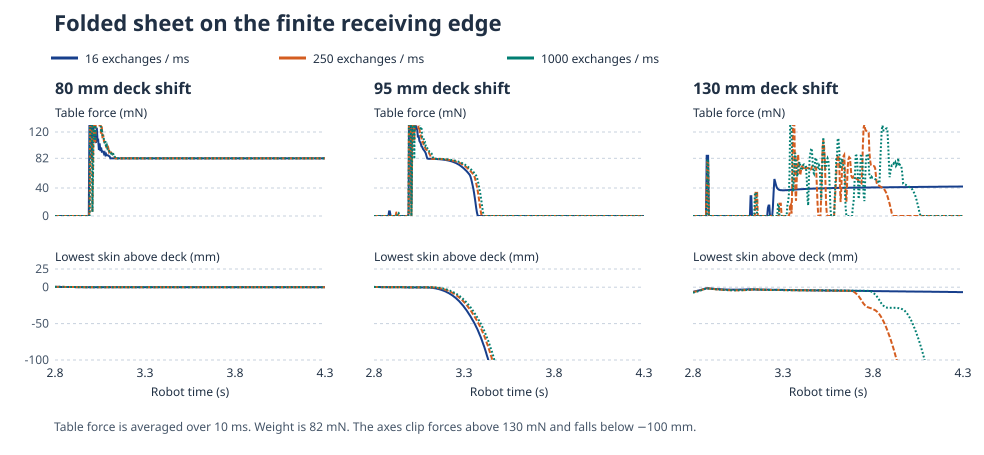
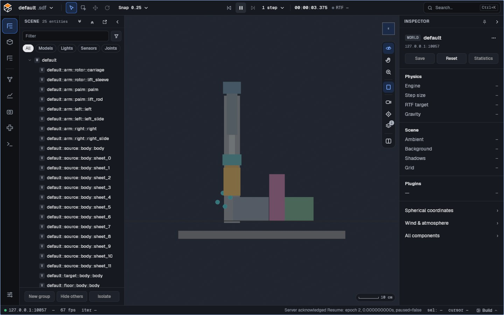

# Placing a folded sheet across a finite table edge

The same gripper lowered an 8.4 g sheet onto a table with its center of mass either 10 mm inside the edge or 5 mm outside. Four of its twelve particle centers overhung the edge in the first case. The table supported the full 82.404 mN weight and the sheet stayed put. In the second case, eight centers overhung the edge. The table carried enough force to authorize release, but the sheet tipped, slid sideways and fell. [Watch it rest](http://127.0.0.1:8082/?backend=primitive&ui=full&quality=low&replay=1&lifecycle=1&url=ws%3A%2F%2F127.0.0.1%3A10056%2F) · [Watch it tip off](http://127.0.0.1:8082/?backend=primitive&ui=full&quality=low&replay=1&lifecycle=1&url=ws%3A%2F%2F127.0.0.1%3A10057%2F) · [Watch the shared load at 16 exchanges](http://127.0.0.1:8082/?backend=primitive&ui=full&quality=low&replay=1&lifecycle=1&url=ws%3A%2F%2F127.0.0.1%3A10058%2F)



## Measuring the force and the edge

The gripper picks up and lowers the sheet with its original 1 ms commands. While it holds the sheet aloft, the 200 × 180 mm receiver moves sideways from 1.500 to 1.900 s. The measured reactions come from two native articulated finger contacts and the finite one-way SDF box. The material has no lower floor assigned for capture after it clears the deck. The offset in the table below is the commanded displacement of the deck from its pickup position. At rest it begins with its edge 90 mm from the center of the sheet.

The controller starts jaw opening after twenty consecutive acceptable 1 ms load measurements and pauses opening if support weakens. It sees the signed vertical reaction and the known weight. A downward reading now contributes zero upward pressure. At 70 mm the measured signed vertical impulse on one tick was −1.06 × 10⁻²² N·s, which previously interrupted the run. Raw signed forces remain in the recording. The centered, separate-commit control reproduced all 4,300 earlier actuator rows byte-for-byte.

For every actuator interval, the measured particle momentum change was checked against gravity plus both jaw impulses and the table impulse. The largest per-tick residual across the three main placements and all four rates was 4.85 × 10⁻¹⁵ N·s. A separate loaded, moving-table regression reconstructs the public angular impulse from four independent solves about a common start-of-step origin. The bounds below use the resultant's intersection with the *top plane*, including the moment from tangential force. They use pad-free intervals in which the table supports at least 25% of the sheet weight. A line of action on the edge can coexist with substantial upward force while the load tips.

| Deck shift | 16 exchanges/ms | 64 exchanges/ms | 250 exchanges/ms | 1,000 exchanges/ms |
|---:|---|---|---|---|
| 0 mm | Rest at 3.138 s | — | — | — |
| 70 mm | Rest at 3.104 s | — | — | — |
| 80 mm | Rest at 3.101 s | Rest at 3.114 s | Rest at 3.126 s | Rest at 3.127 s |
| 95 mm | Fall 3.089 / 3.369 s | Fall 3.101 / 3.381 s | Fall 3.112 / 3.391 s | Fall 3.124 / 3.403 s |
| 130 mm | Held, 42.0 mN | Held, 65.2 mN | Fall 3.531 / 3.904 s | Fall 3.638 / 4.057 s |
| 165 mm | Held, 0.0 mN | — | — | — |

Rest times mark the first fully unloaded jaw sample. Fall times are jaw unloading and the final positive table load. Held values are the mean upward table force over the last 100 ms.

The 16-exchange, 80 mm run placed the center 10.006 mm inside and the reaction between 9.848 and 10.228 mm inside. At 95 mm the center was 5.028 mm outside and the reaction acted within 0.0004 mm of the edge. The sheet moved another 25.93 mm sideways between jaw unloading and its last table load. The final 100 ms of free flight reproduced gravitational acceleration within 1.4 × 10⁻¹¹ m/s². At 165 mm the deck missed entirely. The fingers retained the sheet and the table measured zero through the end of the search.



## Independent time and load comparisons

The 16-, 64- and 250-exchange cases all commit Bevy once per millisecond. Each was also run with one Bevy commit per native exchange for the three main offsets, with two additional controls at 16 exchanges. The two routes produced identical particle states, summed vertical reactions, opening commands and visual streams at all 47,300 compared actuator ticks. All six 16-exchange public trajectories also repeated exactly after ordinary reset.

The 1 µs independent trajectory places the 80 mm case 10.012 mm inside the edge on release. All three public-rate final centers were within 0.012 mm of that reference. In the 95 mm case, the reference unloaded the jaws at 3.124 s and last touched the table at 3.403 s. The 16-, 64- and 250-exchange public cases released 35, 23 and 12 ms earlier. Their maximum center-of-mass errors over the first 100 ms aligned at jaw unloading were 0.107, 0.027 and 0.009 mm. On the unshifted robot clock the final differences were 320, 212 and 110 mm after nearly a second of accelerating free fall. The absolute and aligned comparisons answer different timing questions.

The 130 mm placement depends on native rate. At 16 exchanges the fingers supported 40.38 mN and the table 42.02 mN over the last 100 ms. At 64 exchanges the split was 17.16 and 65.24 mN. At 250 exchanges the table briefly passed the release threshold and the sheet subsequently fell. At 1 µs it also fell, unloading at 3.638 s and leaving the table at 4.057 s, 153 ms later than the 250-exchange run. The two finer runs agree on the eventual fall but do not establish a converged departure time. Before jaw opening the table load's line of action lay at the edge in the falling 95 mm runs. In the stable 80 mm trials its smallest measured margin during the preceding twenty ticks was 2.99 mm across all four rates. A measured edge margin is a candidate input to a release decision.

## Reproduce

The public path admits a linearly translating one-way finite SDF box with the articulated pads and cohesive material under the existing exchange clock. The public maximum is 256 internal exchanges. The independent 1 µs reference advances a separate Bevy/native commit per solve and applies the same 1 ms commands. The ordinary admission still checks constant linear motion and rejects rotation for this public coupling. [SDF operator and measurements](../../../crates/gz-sim-cli/examples/local_robot_foundations/sheet_setdown/edge.rs) · [Regression cases](../../../crates/gz-sim-cli/examples/local_robot_foundations/sheet_setdown/edge_tests.rs) · [Machine-readable receipt](sheet-table-edge.json)

Use a fresh directory for each recording. The first command checks every measured state again after reloading the world. Change the deck shift to 80, 130 or 165 mm for the resting, shared or missed controls.

```sh
RUSTC_WRAPPER= cargo run --locked --release --no-default-features -p gz-sim-cli \
  --example local_robot_foundations -- sheet-edge target/edge-95 \
  --deck-shift-mm 95 --exchanges 16 --verify-reset
RUSTC_WRAPPER= cargo run --locked --release --no-default-features -p gz-sim-cli \
  --example local_robot_foundations -- sheet-edge target/edge-95-reference \
  --deck-shift-mm 95 --exchanges 1000 --separate-native-commits
RUSTC_WRAPPER= cargo run --locked --release --no-default-features -p gz-sim-cli \
  --example local_robot_foundations -- sheet-edge-compare target/edge-95 target/edge-95-reference
RUSTC_WRAPPER= cargo run --locked --release -p gz-sim-cli --bin gz-sim-rs -- \
  docs/measurements/local-manipulation/sheet-table-edge-fall-replay --server --replay --web-viewer 9002
```

For a side view of the sheet leaving the edge, press **1**, frame the scene with **F** and scrub to about 3.375 s. Each saved WebGPU replay checked all 173 frames, 4,325 body poses and shapes, and 2,076 independently sampled particle positions. The earliest frame represents the initial world.

All six new Rust tests, seven previous set-down regressions, three pressure-controller tests and nine exchange-clock tests passed. Strict release Clippy passed for the scene, operator and its tests. LLVM raw profiles were matched to each executable build ID before collecting changed production lines and region start locations against `cdce715`. The scene covered 10/10 lines (100.00%), 10/10 regions (100.00%). The CLI covered 298/302 lines (98.68%), 557/575 regions (96.87%). The impact-failure regression confirms that a 1 ms **unrefined** solve stops with its native unresolved-contact fault and publishes no partial archive.
