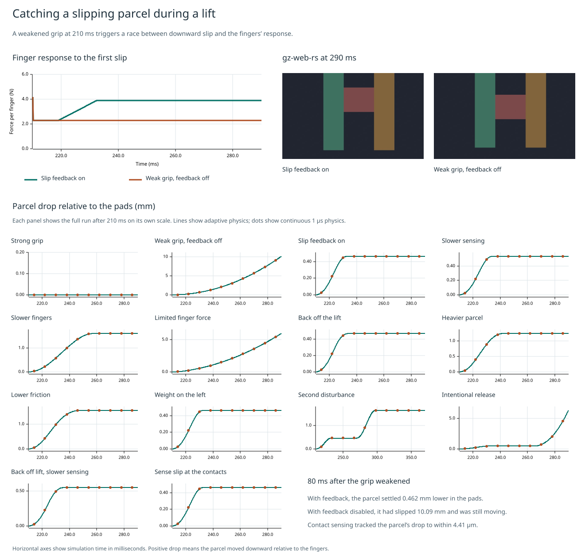

# Watch the gripper catch a slipping parcel

Open the catch replay and press **3** with the pointer over the viewport for a side view. Use **F** or the wheel to fit the gripper, then press **Play**. The green and orange fingers start rising at 150 ms. At 210 ms the grip weakens. Watch the red parcel’s height relative to the fingers as the controller tightens them again. [Watch the catch](http://127.0.0.1:8082/?backend=primitive&ui=full&quality=low&replay=1&lifecycle=1&url=ws%3A%2F%2F127.0.0.1%3A11501%2F) · [Watch the same lift with feedback disabled](http://127.0.0.1:8082/?backend=primitive&ui=full&quality=low&replay=1&lifecycle=1&url=ws%3A%2F%2F127.0.0.1%3A11502%2F)



The fingers first tightened at 219 ms and confirmed the catch at 236.2 ms. At 290 ms the parcel had slipped 0.462 mm with feedback and 10.090 mm with the same initial disturbance and feedback disabled. The plot uses the change in height between the parcel’s center of mass and the moving pads. The two images use the same camera and scale. The contact-sensing run measured the parcel’s drop within 4.41 µm and caught it at 236.0 ms. [Watch the continuously fine catch](http://127.0.0.1:8082/?backend=primitive&ui=full&quality=low&replay=1&lifecycle=1&url=ws%3A%2F%2F127.0.0.1%3A11515%2F) · [Physics measurements and acceptance criteria](slip-catch.md)

## Explore the ten phases

| Phase | What to look for | gz-web-rs replays |
| --- | --- | --- |
| 1. Measure slip | With 4.2 N per finger the red parcel rises with the pads. A 2.3 N grip leaves it sliding. | [Strong grip](http://127.0.0.1:8082/?backend=primitive&ui=full&quality=low&replay=1&lifecycle=1&url=ws%3A%2F%2F127.0.0.1%3A11503%2F) · [Weak grip](http://127.0.0.1:8082/?backend=primitive&ui=full&quality=low&replay=1&lifecycle=1&url=ws%3A%2F%2F127.0.0.1%3A11502%2F) |
| 2. Detect and catch | Watch the weak grip recover, then compare feedback based on the virtual contact sensors. | [Standard catch](http://127.0.0.1:8082/?backend=primitive&ui=full&quality=low&replay=1&lifecycle=1&url=ws%3A%2F%2F127.0.0.1%3A11501%2F) · [Contact sensing](http://127.0.0.1:8082/?backend=primitive&ui=full&quality=low&replay=1&lifecycle=1&url=ws%3A%2F%2F127.0.0.1%3A11514%2F) |
| 3. Slow the sensor | Sampling every 5 ms gives the parcel more time to slide between readings. | [5 ms sensor](http://127.0.0.1:8082/?backend=primitive&ui=full&quality=low&replay=1&lifecycle=1&url=ws%3A%2F%2F127.0.0.1%3A11504%2F) |
| 4. Slow the fingers | The motor takes longer to build force at 30 N/s. | [Slower fingers](http://127.0.0.1:8082/?backend=primitive&ui=full&quality=low&replay=1&lifecycle=1&url=ws%3A%2F%2F127.0.0.1%3A11505%2F) |
| 5. Cap the squeeze | A 2.55 N ceiling leaves the parcel moving inside the fingers. | [Squeeze limit](http://127.0.0.1:8082/?backend=primitive&ui=full&quality=low&replay=1&lifecycle=1&url=ws%3A%2F%2F127.0.0.1%3A11506%2F) |
| 6. Ease the lift | Both runs reduce lift effort after the applied squeeze stays at its limit and the parcel is still slipping. | [Ease the lift](http://127.0.0.1:8082/?backend=primitive&ui=full&quality=low&replay=1&lifecycle=1&url=ws%3A%2F%2F127.0.0.1%3A11512%2F) · [Slower sensor and lift relief](http://127.0.0.1:8082/?backend=primitive&ui=full&quality=low&replay=1&lifecycle=1&url=ws%3A%2F%2F127.0.0.1%3A11513%2F) |
| 7. Increase the load | The 260 g parcel travels farther between the pads before it settles. | [Heavier parcel](http://127.0.0.1:8082/?backend=primitive&ui=full&quality=low&replay=1&lifecycle=1&url=ws%3A%2F%2F127.0.0.1%3A11507%2F) |
| 8. Change the contact | Lower friction increases slip. Moving the weight to the opposite side leaves the catch distance nearly unchanged. | [Lower friction](http://127.0.0.1:8082/?backend=primitive&ui=full&quality=low&replay=1&lifecycle=1&url=ws%3A%2F%2F127.0.0.1%3A11508%2F) · [Mirrored weight](http://127.0.0.1:8082/?backend=primitive&ui=full&quality=low&replay=1&lifecycle=1&url=ws%3A%2F%2F127.0.0.1%3A11509%2F) |
| 9. Catch a second slip | The stronger lift at 270 ms causes another slide after the first catch. Continue through 301.2 ms. | [Two catches](http://127.0.0.1:8082/?backend=primitive&ui=full&quality=low&replay=1&lifecycle=1&url=ws%3A%2F%2F127.0.0.1%3A11510%2F) |
| 10. Open on command | At 265 ms the fingers open and the parcel falls as the lift continues. | [Release](http://127.0.0.1:8082/?backend=primitive&ui=full&quality=low&replay=1&lifecycle=1&url=ws%3A%2F%2F127.0.0.1%3A11511%2F) |

## Run a fresh recording

From this simulator checkout, use a fresh output directory. The first command runs the local Bevy simulation and records one frame per millisecond. The second starts the Rust replay server.

```sh
export RUSTC_WRAPPER=
cargo run --locked --release --no-default-features -p gz-sim-cli --example closed_loop_carry -- \
  catch adaptive target/my-slip-catch
cargo run --locked --release --no-default-features -p gz-sim-cli --bin gz-sim-rs -- \
  --server --replay --web-viewer 11521 target/my-slip-catch/epoch-0
```

Leave the replay server running and open the local gz-web-rs frontend. To run the 1 µs continuous reference, use `fine` in place of `adaptive` and a new output directory. [Open your recording](http://127.0.0.1:8082/?backend=primitive&ui=full&quality=low&replay=1&lifecycle=1&url=ws%3A%2F%2F127.0.0.1%3A11521%2F) · [Starting the local frontend](../../LOCAL_RIGID_ROBOT.md#watch-the-current-local-robot-experiments)

## Use the measured recordings

The portable archive includes all 28 recordings, native measurements at every 200 µs public tick, state transitions and the Rust chart source. The chart checks the recorded pad heights and parcel center of mass against native readings at every shared frame after time zero. The WebGPU viewer played and rewound all 14 adaptive recordings and the fine catch, matching 17,780 visual poses and shapes across 4,445 frames. Extract the directory anywhere and point the replay server at the desired `CASE-MODE/epoch-0` directory. For example, `repeat-adaptive/epoch-0` contains the double catch. [Download the replay and measurements bundle](slip-catch-view.tar.xz)

```sh
study=target/slip-catch-recordings
mkdir -p "$study"
tar -xJf docs/measurements/local-manipulation/slip-catch-view.tar.xz -C "$study"
(cd "$study" && sha256sum --quiet --check SHA256SUMS)
cargo run --locked --release --manifest-path "$study/plot/Cargo.toml" -- \
  "$study" "$study/regenerated.svg" "$study/regenerated.json"
```
