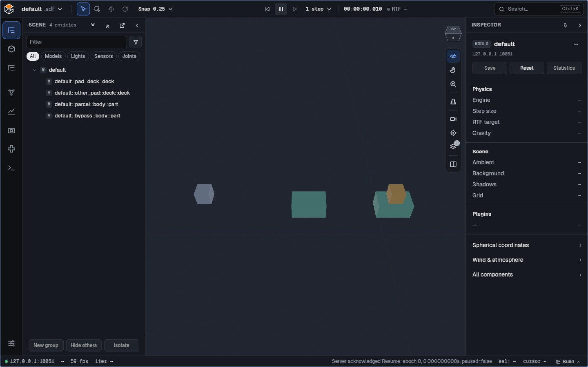

# A parcel crosses a narrow sorting pad between controller samples

A 10 g parcel reaches a 12 mm wide pad halfway through a 20 ms public step. At both ends of the predicted path their horizontal footprints are clear. The finite-face detector now tests the time at which two translating boxes first touch the chosen plane and clips the incident hull against the actual pad. Only the crossing pair asked for a finer step. The parcel in the second lane passed freely with 46 mm of lateral clearance. [SDF world](../../../examples/worlds/local_sorter_crossing.sdf)

The first positive interval ended at 10.0 ms and delivered 0.04000008 N·s vertically, consistent with stopping 10 g moving down at 4 m/s. The complete body state at 20 ms matched a separately loaded continuous 200 µs simulation. Only the first public tick requested 100 native steps. The other three ran at the ordinary rate. Resetting the world reproduced the event and its impulse. Against an independent 100 µs trajectory, the ordinary step misplaced the parcel by 23.05 mm at the next controller reading. The adaptive step reduced that error to 0.00249 mm. [Per-tick position and rotation measurements](sorter-crossing.json)

| Time | Ordinary position error | Adaptive position error | Ordinary rotation error | Adaptive rotation error |
|---|---:|---:|---:|---:|
| 20 ms | 23.05 mm | 0.00249 mm | 0.056° | 0.036° |
| 80 ms | 22.63 mm | 0.00010 mm | 55.14° | 0.021° |

The inter-sample crossing calculation assumes constant translation during the prediction. Rotating boxes retain the existing endpoint test. The frictionless, gravity-free fixture isolates the impact from gravity and sliding friction. All 20 policy tests and 344 scene library tests passed. All 29 changed executable lines and all 66 regions ran in the coverage build. WebGPU verified all 5 public frames and 401 continuous frames, then rewound both recordings to zero. [Native public replay](http://127.0.0.1:8082/?backend=primitive&ui=full&quality=low&replay=1&lifecycle=1&url=ws%3A%2F%2F127.0.0.1%3A10060%2F) · [Slow-motion contact replay](http://127.0.0.1:8082/?backend=primitive&ui=full&quality=low&replay=1&lifecycle=1&url=ws%3A%2F%2F127.0.0.1%3A10061%2F) · [Portable recordings and comparison worlds](sorter-crossing.tar.xz)



Run the public simulation from the workspace root. Replace the SDF with the archived fine.sdf and run 400 steps to record the intermediate contact frames. The local robot guide gives the command to open a recording in gz-web-rs. [Viewer instructions](../../LOCAL_RIGID_ROBOT.md)

```sh
RUSTC_WRAPPER= cargo run --release --locked --no-default-features -p gz-sim-cli \
  --example local_robot_foundations -- record examples/worlds/local_sorter_crossing.sdf 4 1 target/sorter
```
