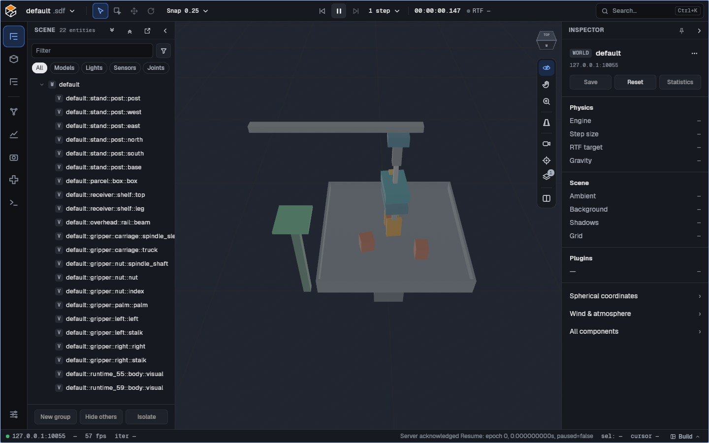

<!-- Copyright (C) 2026 Open Source Robotics Foundation -->
<!-- SPDX-License-Identifier: Apache-2.0 -->

# Apply a force to one of two spawned parcels

The serial gripper bench drops two identical 200 g parcels side by side. A single 60 N force acts 20 mm off-center on one parcel for one millisecond. At 100 ms it has moved 29.87 mm sideways and turned 52.66°. Its twin falls to the same height with zero sideways travel or rotation. Both first contact the tray at 147 ms. [Watch every millisecond in gz-web-rs](http://127.0.0.1:8082/?backend=primitive&ui=full&quality=low&replay=1&lifecycle=1&url=ws%3A%2F%2F127.0.0.1%3A10055%2F) · [Numerical results](spawned-parcel-load.json)

The input journal can address a single-link clone by its live spawn alias in either a point force or an ordinary wrench. Removing the clone or resetting the world retires its alias and cancels its queued load. Reusing the name creates a new, unloaded parcel. Existing journals can still address original links by scoped SDF name. [Example journal](../../../examples/replay/spawned_parcel_load.json)

The measured force has an equivalent moment of −1.2 N·m and gives 0.3 m/s horizontal speed after the first millisecond. Running the equivalent wrench in an independent eight-thread process reproduced all 205 state observations. Saving every step produced 203 viewer frames, including the initial state and the two spawns at time zero. Saving every tenth step produced 23 frames and the same physics trace. The browser checked 4,463 displayed poses and shapes at the finer interval and rewound to the start. Thirteen journal integration tests and three binary unit tests passed. The two changes covered 29/29 production lines and 63/65 regions. [Portable full-rate replay](spawned-parcel-load.tar.xz) · [Watch at the default frame interval](http://127.0.0.1:8082/?backend=primitive&ui=full&quality=low&replay=1&lifecycle=1&url=ws%3A%2F%2F127.0.0.1%3A10054%2F)



Run from the physics checkout with a fresh output directory.

```sh
RUSTC_WRAPPER= cargo run --release --locked --no-default-features -p gz-sim-cli \
  --bin gz-sim-local-replay -- examples/worlds/local_robot_replay.sdf \
  examples/replay/spawned_parcel_load.json --record target/parcel-view --record-every 1
RUSTC_WRAPPER= cargo run --release --locked --no-default-features -p gz-sim-cli \
  --bin gz-sim-rs -- --server --replay --web-viewer 18142 target/parcel-view/epoch-0
```

Choose a larger positive recording interval to fit a longer run within the archive's 4,096-frame limit per epoch. Spawn, removal, reset and the final state retain their frames between scheduled samples. The physics and trace continue to use the SDF timestep. [Open your recording](http://127.0.0.1:8082/?backend=primitive&ui=full&quality=low&replay=1&lifecycle=1&url=ws%3A%2F%2F127.0.0.1%3A18142%2F) · [Starting the frontend](../../LOCAL_RIGID_ROBOT.md#watch-the-current-local-robot-experiments)
