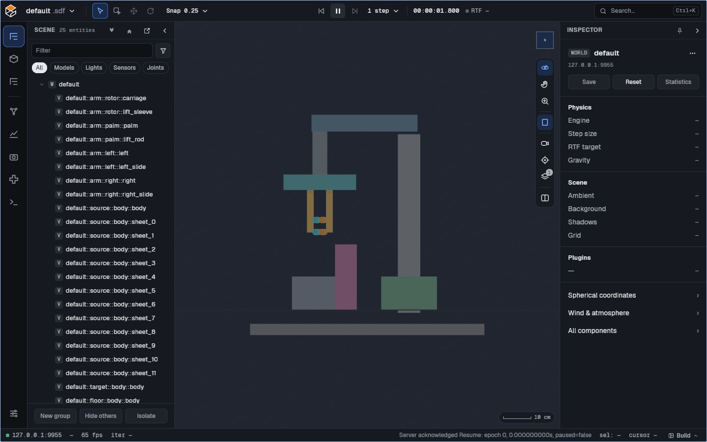

<!-- Copyright (C) 2026 Open Source Robotics Foundation -->
<!-- SPDX-License-Identifier: Apache-2.0 -->

# A closing cloth edge between stiff spring jaws

The 8.4 g folded sheet used to stop the simulation 640 ms into pickup. At native step 40,926, a pair of cloth edges had reached contact and was still closing at 0.414 mm/s. The finite springs on both jaws already supplied their endpoint forces. The remaining motion was between the material edges. The solver now resolves their closing speed and rechecks any single rigid support while retaining the swept positions, finite pad forces and friction limits. Two distinct hard supports still require a separate coupled solution. [Captured inputs and regression](../../../crates/gz-physics-xpbd/tests/private/stiff_pad_endpoint.rs)

The same loaded state now passes at one, two, four and eight material substeps. Both jaws report reactions, normal and frictional impulses respect the friction bound, and the whole-sheet momentum residual is below 10⁻¹³ N·s. All 190 XPBD release tests passed. The changed solver covered 18/18 executable lines and 34/34 regions. [Measurements](spring-pad-endpoint.json)

| Native exchanges per 1 ms actuator period | Left jaw up (N) | Right jaw up (N) | Interpanel normal force (N) | p95 physics time per actuator period (ms) |
|---:|---:|---:|---:|---:|
| 64 | 0.11366 | −0.03132 | 0.02465 | 27.05 |
| 100 | 0.02185 | 0.06018 | 0.01322 | 38.79 |
| 125 | 0.04289 | 0.03952 | 0.00000 | 42.16 |
| 160 | 0.02062 | 0.06184 | 0.01041 | 48.57 |
| 200 | 0.06254 | 0.01954 | 0.01038 | 61.40 |
| 250 | 0.07396 | 0.00833 | 0.01496 | 73.23 |

Each full 3.4 s run used two 2.8125 g jaws, pad compliance 0.000015625 m/N, 1.5 N·s/m damping and exactly 3,400 actuator updates. Every rate completed pickup and release. The 125-exchange run passed the standalone grasp checks, but each jaw's force varies across finer runs, so this pad is outside the qualified force range. The reported p95 values sum native physics costs over 1 ms of simulation on a shared workstation. Each playback independently verified 137 frames and 3,425 rendered poses and shapes. [64 exchanges in gz-web-rs](http://127.0.0.1:8082/?backend=primitive&ui=full&quality=low&replay=1&lifecycle=1&url=ws%3A%2F%2F127.0.0.1%3A9955%2F) · [125 exchanges in gz-web-rs](http://127.0.0.1:8082/?backend=primitive&ui=full&quality=low&replay=1&lifecycle=1&url=ws%3A%2F%2F127.0.0.1%3A9956%2F)

Use the [gripper study commands](sheet-jaw-convergence.md) with `--pad-compliance 0.000015625`, `--jaw-mass-scale 0.015625`, `--tune-damping`, `--substeps 1` and the desired `--exchanges-per-ms`.

Signed per-particle forces subsequently localized the unequal jaw loads to the bending of the fold. [Panel force balance and instrumented replays](fold-force-balance.md)
