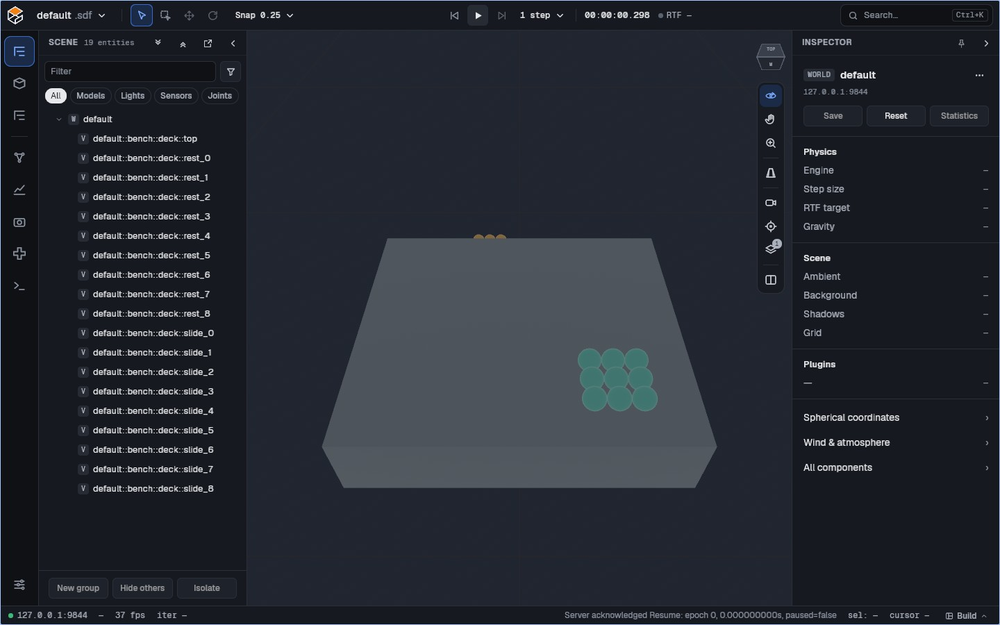

# Cloth on a finite SDF bench

The teal sheet falls onto a 32 × 36 cm tabletop. The orange sheet slides off its edge and falls under gravity. Both sheets use the same material, nine particles weighing 4 g each, and a Coulomb friction coefficient of 0.1. [Open the bench in gz-web-rs](http://127.0.0.1:8082/?backend=primitive&ui=full&quality=low&replay=1&lifecycle=1&url=ws%3A%2F%2F127.0.0.1%3A9844%2F)



| Measurement from the 320 ms run | Result |
| --- | ---: |
| Resting sheet first touches the bench | 118 ms |
| Settled upward reaction | 0.353160 N |
| Expected weight | 0.353160 N |
| Sliding sheet last touches the bench | 75 ms |
| Peak sliding friction force while wholly over the tabletop | 0.741636 N |
| Highest point of departed sheet at 320 ms | 0.150695 m |
| Tabletop height | 0.440000 m |

The ordinary loader resolves the bench link and its offset, rotated SDF collision. The solver sweeps each material particle's spherical skin against the six faces, twelve edges and eight corners. It records reaction impulse and moment about the collision center. The static bench stays fixed. This covers particle-to-box contact on a cloth mesh. Narrow objects that pass only through a triangle interior require separate face contact.

A rotated-box test checks the top, side, underside, edge and corner using an 80 m/s incoming particle. It verifies the resulting position and the linear and angular impulses. Other tests check an exact end-of-tick arrival, grazing and friction, rounded-corner clearance, and culling of distant boxes. A folded-cloth test places the finite bench alongside two dynamic spherical gripper pads. Across the first 30 ms, sheet particles agree with the existing wide-plane reference within 1 µm.

The ordinary replay sampled 10 frames through 298 ms and the independent physics trace covered all 321 public states. gz-web-rs checked all 190 displayed poses and shapes and rewound to the initial state. Strict Clippy passed. LLVM exercised all 81 changed executable lines and 157 of 158 changed source regions.

## Reproduce

Run the tests from the repository root.

```sh
RUSTC_WRAPPER= cargo test --release --locked -p gz-physics-xpbd --test static_box
GZ_STATIC_BENCH_MEASUREMENT="$PWD/target/soft-bench" RUSTC_WRAPPER= \
  cargo test --release --locked -p gz-sim-scene --test static_soft_bench
```

Record 320 public ticks to a fresh directory. Then use the replay command with the local gz-web-rs frontend.

```sh
RUSTC_WRAPPER= cargo run --release --locked -p gz-sim-cli --bin gz-sim-rs -- \
  examples/worlds/local_soft_static_bench.sdf --physics-engine multifidelity \
  --server --run --iterations 320 --web-lifecycle --web-viewer 9860 \
  --record-scene target/soft-bench/replay
RUSTC_WRAPPER= cargo run --release --locked -p gz-sim-cli --bin gz-sim-rs -- \
  --server --replay --web-viewer 9860 target/soft-bench/replay
```

[Open the locally regenerated replay](http://127.0.0.1:8082/?backend=primitive&ui=full&quality=low&replay=1&lifecycle=1&url=ws%3A%2F%2F127.0.0.1%3A9860%2F)
