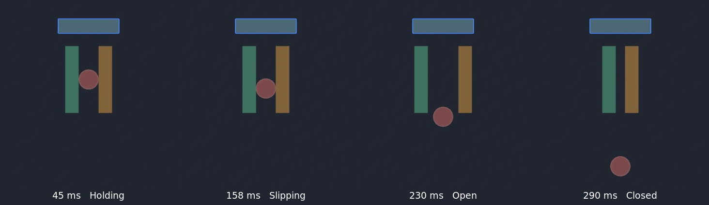

<!-- Copyright (C) 2026 Open Source Robotics Foundation -->
<!-- SPDX-License-Identifier: Apache-2.0 -->

# Two fingers hold and release a parcel

The orange and green pads initially squeeze the red 200 g sphere with 3 N each. At 50 ms each motor drops to 1.5 N. Friction then supports only part of the sphere’s weight and it slides 13.97 mm before the motors open the fingers at 160 ms. At 240 ms the motors close the empty fingers. The sphere has fallen 129.91 mm by the final frame at 290 ms. Press Play in the viewer, or use Step to advance one millisecond per frame. Press **3** over the viewport for a side view. [Open in gz-web-rs](http://127.0.0.1:8082/?backend=primitive&ui=full&quality=low&replay=1&lifecycle=1&url=ws%3A%2F%2F127.0.0.1%3A11429%2F)



Each image uses the same camera, crop and scale. WebGPU playback checked the four visuals’ positions, orientations, shapes and colors and the object catalog at all 291 frames, then reset to time zero. Each visual matched a separate Bevy run’s link translation and orientation to within 1e-12 per component. With one and eight Bevy worker threads, all 2,910 journal records and both native recording files matched exactly. [Portable recording, camera settings, native link observations and browser receipt](two-finger-view.tar.xz)

The three joint encoders independently located the pad centers within 5.73e-17 m of the displayed positions. Summing both contact impulses on the parcel and its weight each 100 µs gives a final downward speed of 1.52936 m/s. Treating the impulse as centered within each public tick reconstructed the entire displayed trajectory within 19.12 µm vertically and 2.23 µm horizontally. The four-body pose comparison uses native steps directly and does not make that timing approximation. [Impulse and encoder check](../../../tools/physics-audit/numerics/src/bin/two_finger_view.rs)

## Run locally

From the simulator checkout, serve the portable recording on a free port. With the gz-web-rs frontend already running on port 8082, the link opens the recorded scene. [Open the reproduced replay](http://127.0.0.1:8082/?backend=primitive&ui=full&quality=low&replay=1&lifecycle=1&url=ws%3A%2F%2F127.0.0.1%3A11432%2F)

```sh
export RUSTC_WRAPPER=
study=target/two-finger-view
mkdir -p "$study"
tar -xJf docs/measurements/local-manipulation/two-finger-view.tar.xz -C "$study"
cargo run --locked --release --no-default-features -p gz-sim-cli --bin gz-sim-rs -- \
  --server --replay --web-viewer 11432 "$study/result/epoch-0"
```

To reproduce the physical recording in a fresh directory and compare thread counts, run the commands below. The Chromium audit uses the running frontend and replay server above and requires an available WebGPU adapter.

```sh
export RUSTC_WRAPPER=
study=target/two-finger-view
world=examples/worlds/local_two_finger_load.sdf
journal=examples/replay/two_finger_load.json
cargo build --locked --release --no-default-features -p gz-sim-cli --bin gz-sim-local-replay
target/release/gz-sim-local-replay "$world" "$journal" --threads 1 \
  --trace "$study/trace.jsonl" --record "$study/fresh" --record-every 10
target/release/gz-sim-local-replay "$world" "$journal" --threads 8 \
  --verify "$study/trace.jsonl" --record "$study/eight" --record-every 10 > /dev/null
cmp "$study/fresh/epoch-0/frames.jsonl" "$study/eight/epoch-0/frames.jsonl"
cmp "$study/fresh/epoch-0/manifest.json" "$study/eight/epoch-0/manifest.json"
cmp "$study/fresh/epoch-0/frames.jsonl" "$study/result/epoch-0/frames.jsonl"
cargo run --locked --release --manifest-path tools/physics-audit/numerics/Cargo.toml \
  --bin two_finger_view -- "$study/trace.jsonl" "$study/fresh/epoch-0"
cargo run --locked --release --manifest-path tools/physics-audit/browser/Cargo.toml -- \
  "$study/result/epoch-0" "$study/archive-index.json" "$study/screenshots" 11432
```

## Recorded evidence

The recording used the local CPU Rapier configuration and the public deterministic command journal.

| Item | SHA-256 |
| --- | --- |
| Replay executable | `7bac1a3b5e3bec3fe3474b1f34d6b54a5ca9cf9322c3ea11a3bc36fcb59332c3` |
| World | `0ff8cbe56a886435277723f3c1ab47e5cf6873da9aa01ec56d6ec790d4ff8563` |
| Command journal | `2706ac16f5bd005ebff5ec69a8a66e344f604a369490629c6d72918b0d09c698` |
| Native frame stream | `b525c759fb32030fafa5a5da10621535ef87c59ac26d4912bb0fa139a9d48958` |
| Recording manifest | `cfa7675b6bf3c7ff006e7256cc3918bfd9da525adb25dad5621ecf17e0586b2d` |

The numerical checker passed the native replay and rejected 28 corrupted or incomplete inputs, including missing tangents, swapped body identities, a displaced pad and a modified impulse. LLVM covered 101/101 lines and 238/246 regions of the checker. All ten browser audit tests passed. The real WebGPU run and the loopback refusal tests covered 43/43 changed browser lines and 97/98 changed regions, including tests. Both tools passed strict Clippy.
