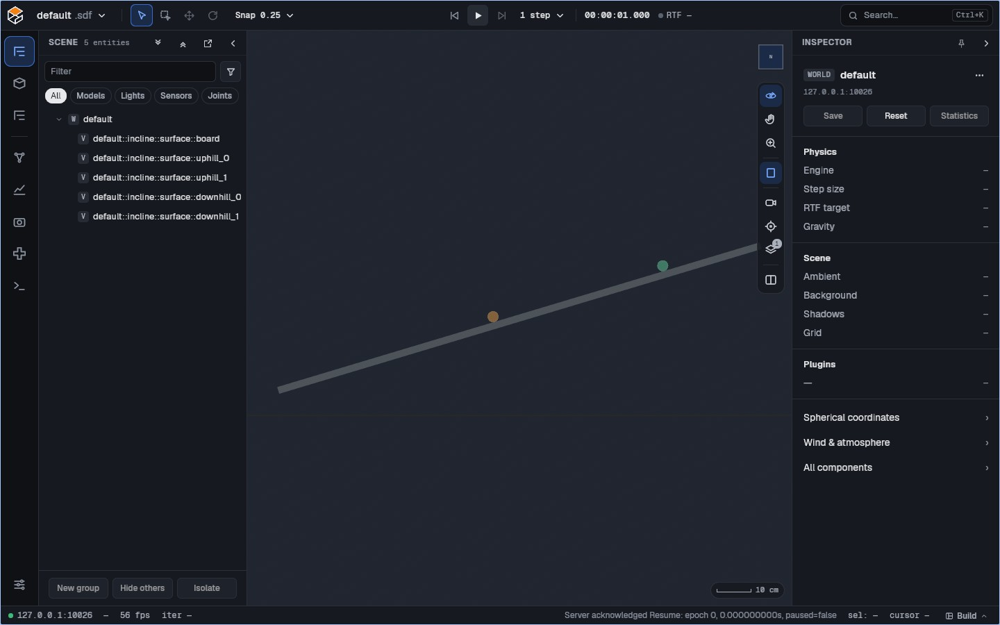

<!-- Copyright (C) 2026 Open Source Robotics Foundation -->
<!-- SPDX-License-Identifier: Apache-2.0 -->

# An uphill slide stops on the incline

Two equal cable strips start at 5 mm/s on a 30% slope, one uphill and one downhill. With static friction 0.6, sliding friction 0.2, downhill acceleration from gravity 3 m/s² and normal acceleration 10 m/s², the green uphill strip must stop after 1 ms, 2.5 µm from its start. The orange downhill strip continues to accelerate at 1 m/s². Both motions occur in one Rust/Bevy world. [Authored scene](../../../examples/worlds/local_material_slip_arrest.sdf) · [Corrected run](http://127.0.0.1:8082/?backend=primitive&ui=full&quality=low&replay=1&lifecycle=1&url=ws%3A%2F%2F127.0.0.1%3A10026%2F) · [Earlier solver](http://127.0.0.1:8082/?backend=primitive&ui=full&quality=low&replay=1&lifecycle=1&url=ws%3A%2F%2F127.0.0.1%3A10027%2F)

| Measured downslope displacement at the 10 ms physics step | 100 ms | 1 s |
|---|---:|---:|
| Uphill strip, previous law | +5.000 mm | +500.000 mm |
| Uphill strip, corrected law | −0.0025 mm | −0.0025 mm |
| Downhill strip, either law | +6.000 mm | +510.000 mm |

The position projection now splits a straight sliding interval at its predicted stop if static friction can hold the remaining load. The velocity solve applies the endpoint reaction. Tests cover a stationary floor, a moving belt and independent signed momentum balance. A transverse load can turn the sliding direction and continues to use the vector friction solve. Older material checkpoints keep the original equations and identities. Golden traces captured from two earlier solvers check their binary restarts.

The flat face of a tilted box gave the same result as a plane. With 1, 2, 4 and 8 material substeps per 10 ms tick, the entire stop fitted within the first substep and the travel was 2.5 µm. With 16 and 32 substeps, the preceding sliding intervals used the ordinary first-order position update and produced 1.52 and 1.77 µm of uphill travel. All twelve controls stayed at rest after the first public tick. Downhill displacement at the coarsest setting includes the normal 5 mm semi-implicit integration error after one second.

Four independently repeated timed gripper runs at 16, 500, 1,000 and 2,000 exchanges per millisecond reproduced the previous particle traces, panel forces and native replay frames byte for byte. The finest two timed-release trajectories still differed by 0.3283 mm. Four load-confirmed controller controls reproduced all 4,300 observations per trial, including the finite bench and withdrawn-bench cases. [Load-confirmed placement](sheet-supported-setdown.md)

All 234 active XPBD tests passed. One unrelated benchmark remains ignored. Strict Clippy passed with and without optional features. LLVM covered all 62 changed executable lines and all 88 changed regions. Each WebGPU recording checked 505 poses and shapes across 101 frames and rewound to zero. [Measurements and coverage](uphill-slip-arrest.json) · [Portable before-and-after recordings](uphill-slide-replays.tar.xz)



```sh
export RUSTC_WRAPPER=
cargo run --locked --release --no-default-features -p gz-sim-cli --example local_robot_foundations -- \
  record examples/worlds/local_material_slip_arrest.sdf 100 1 uphill-recording
cargo run --locked --release --no-default-features -p gz-sim-cli --bin gz-sim-rs -- \
  --server --replay --web-viewer 10026 uphill-recording/replay
```
