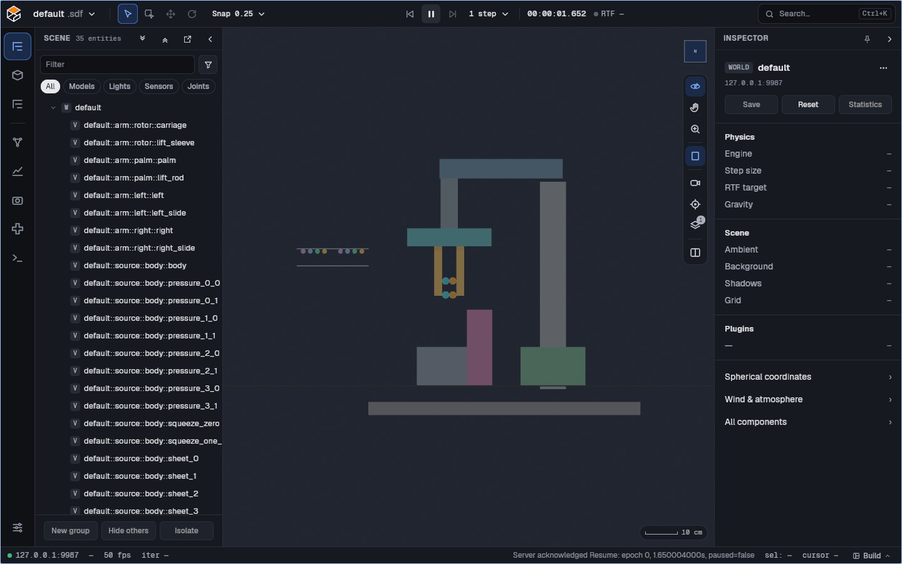

<!-- Copyright (C) 2026 Open Source Robotics Foundation -->
<!-- SPDX-License-Identifier: Apache-2.0 -->

# Keeping a folded sheet in contact with both fingertips

The spring-only fingertips simultaneously lost pressure 182 times during a 300 ms hold. Their combined time open was 113.876 ms. Adding 4 N·s/m of normal damping per fingertip contact kept both fingers loaded at all 75,000 native measurements at the same rate. Each jaw supported 41.205 mN upward and squeezed with 0.825 N. The 8.4 g sheet rose 149.62 mm. [Spring-only replay](http://127.0.0.1:8082/?backend=primitive&ui=full&quality=low&replay=1&lifecycle=1&url=ws%3A%2F%2F127.0.0.1%3A9980%2F) · [Damped replay](http://127.0.0.1:8082/?backend=primitive&ui=full&quality=low&replay=1&lifecycle=1&url=ws%3A%2F%2F127.0.0.1%3A9987%2F) · [Full measurements](viscous-gripper-pads.json)



Both clips start at the first observed hold endpoint, 1.650004 seconds. At that point the original pads already had gaps of 26.54 and 23.03 µm. Each clip repeats 750 measured jaw movements from its own complete initial material state. The four colored markers per jaw use one, two, four and eight cloth steps per movement. The horizontal lines mark zero and one newton. The one-step branch reproduced every native particle position, velocity and boundary impulse. The spring-only pads lost pressure together in 268 of 750 intervals at one step and 266 at eight. With viscosity the pads stayed loaded in every interval at every resolution. The independent archive check verified all 1,208 pressure marker heights per clip. The WebGPU viewer checked 151 frames and 1,812 cloth positions per clip.

The gripper uses two 2.8125 g jaws, pad compliance of 15.625 µm/N, joint damping of 1.5 N·s/m and hinge damping of 0.001 N·m·s/rad. The compliant cuboid takes an optional SDF `normal_damping` in N·s/m per particle, scaled with the pad quadrature weight. A receding pad can unload completely. A pinned particle can transmit a reaction. The same Rust material solve supplies the rigid reaction. Independent tests exercise a damped mass, moving boundaries, contact entry, separation, invalid coefficients and checkpoint continuation. [Contact implementation](../../../crates/gz-physics-xpbd/src/collision/compliant.rs) · [Hinge measurements](cloth-bending-damping.md)

| Exchanges per 1 ms command | Maximum particle disagreement during hold vs 1,000 | Maximum during 3.4 s pickup and release | p95 per 1 ms command |
|---:|---:|---:|---:|
| 16 | 24.97 µm | 252.83 µm | 5.99 ms |
| 125 | 3.24 µm | 238.98 µm | 42.50 ms |
| 250 | 2.77 µm | 249.95 µm | 82.09 ms |
| 500 | 1.45 µm | 210.89 µm | 140.06 ms |
| 1,000 | reference | reference | 294.98 ms |

The controller remained at 1 ms. These runs exchanged rigid and cloth impulses at shorter native world ticks. Damping sustained pressure from 16 through 1,000 exchanges per millisecond. Four and eight exchanges failed the grasp check. At 500 and 1,000 exchanges the trajectories first exceeded the 100 µm tolerance at the 2.700 s snapshot as the jaws opened. Their maximum difference was 210.89 µm at 2.725 s. The complete release therefore still requires investigation. Positions were compared every 25 ms, and the p95 figures include normal shared-host variation.

LLVM exercised 396/399 changed production lines (99.25%) and 679/703 regions (96.59%) for the contact measurements, replay and damping. The damping-specific counts were 132/133 and 199/202. The baseline with zero damping reproduced the original force recording, particle recording and Web replay byte for byte.

Run the native comparison from the physics checkout. Omit the last two options for the full 3.4 s pickup and release. Repeat with `--pad-damping 0` to view the spring-only control.

```sh
export RUSTC_WRAPPER=
cargo run --release --locked --no-default-features -p gz-sim-cli --example local_robot_foundations -- \
  sheet-jaws artifacts/my-fingertips --jaw-mass-scale 0.015625 --pad-compliance 0.000015625 \
  --tune-damping --bend-damping 0.001 --pad-damping 4 --panel-balance \
  --exchanges-per-ms 250 --substeps 1 --inspect-native-tick 412501 --inspect-native-count 750
cargo run --release --locked -p gz-sim-cli --bin gz-sim-rs -- \
  --server --replay --web-viewer 9987 artifacts/my-fingertips/replay
```
