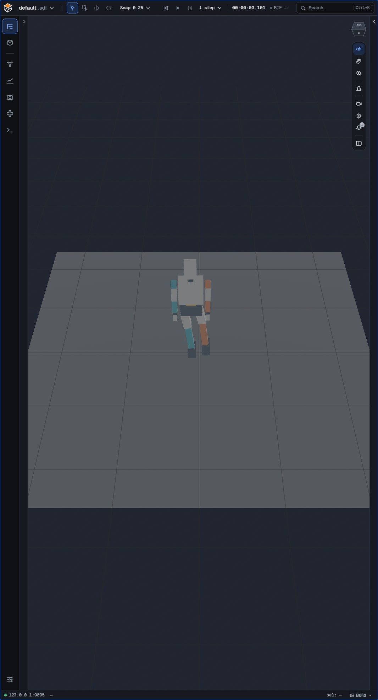

<!-- Copyright (C) 2026 Open Source Robotics Foundation -->
<!-- SPDX-License-Identifier: Apache-2.0 -->

# Heading feedback during the first humanoid step

The 30-axis local humanoid used the measured pelvis heading while both feet were planted, then progressively transferred the right hip's correction to the measured heading of the swinging right foot. A regression runs the ordinary SDF posture plugin at 1 ms. It applies a 20 N m yaw torque at the pelvis for the first tick and independently reconstructs the commands from public link rotations and native joint angles. With a gain of 0.6, all six checked hip targets agreed within 10⁻¹² rad. [Regression](../../../crates/gz-sim-scene/tests/walk_heading.rs)

| Incoming time | Swing contribution to right hip | Pelvis yaw error | Right foot yaw error | Right hip observation | Next right hip target |
|---|---:|---:|---:|---:|---:|
| 1 ms | 0% | +0.000067652 | −0.000000001 | −0.000067653 | −0.000027061 |
| 2,725 ms | 50% | −0.002339667 | −0.003709802 | −0.000787167 | −0.000376127 |
| 3,100 ms | 100% | +0.000478220 | +0.001034751 | +0.000766195 | +0.000145345 |

Angles are radians. The stance hip adds the pelvis correction to its current angle. The unloaded foot's yaw correction acts in the opposite direction to its own measured error. Reset restored the authored pose and cleared all changed setpoints. Repeating the initial torque produced the same two hip commands exactly.

With the right hip limited to ±10⁻⁷ rad, the same test in both torque directions produced unrestricted requests of −0.00003448832 and +0.00003448831 rad. The commanded values reached exactly their respective stops. Further cases exercise invalid gains, incompatible walking mode, reversed yaw axis, missing left or right yaw joint, and binding or driving after the native pelvis or a foot has been removed.

An additional launch used the existing local CLI humanoid viewer with zero external push. After 3,101 ticks it showed the robot upright with four loaded contact points on the left sole, a reaction of 733.98 N, and zero force at the right sole and the other links. The gz-web-rs WebGPU client received all 32 visuals at that time. [Open the paused humanoid in gz-web-rs](http://127.0.0.1:8082/?backend=primitive&ui=full&quality=low&url=ws%3A%2F%2F127.0.0.1%3A9895%2F)



The four headless controller regressions passed in 1.8 seconds in release mode. LLVM measured 76/76 lines, 148/153 regions (96.73%) and 9/9 functions in the scene heading controller. Strict Clippy passed. The existing humanoid example passed all five enabled local tests, including sustained sole loading, torque replay, physical swing and the ordinary SDF reset. Its standalone SDF exporter also produced a walk with the requested gain. This qualification changed tests only. [Measured receipt](walk-heading.json)

```sh
export RUSTC_WRAPPER=
cargo test --release --locked --no-default-features -p gz-sim-scene --test walk_heading -- --nocapture
cargo run --release --locked -p gz-sim-cli --features distributed-physics --example humanoid_stand -- \
  --motion walk --authored-footsteps --support-relative --heading-gain 0.6 --push-x 0 --ticks 3101 --web-viewer 9896
```

The Cargo feature enables the existing humanoid example. These commands run its local Bevy simulation. With gz-web-rs on port 8082, [open the new session](http://127.0.0.1:8082/?backend=primitive&ui=full&quality=low&url=ws%3A%2F%2F127.0.0.1%3A9896%2F).
