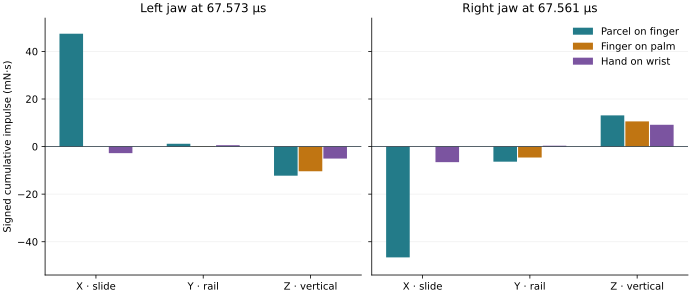

<!-- Copyright (C) 2026 Open Source Robotics Foundation -->
<!-- SPDX-License-Identifier: Apache-2.0 -->

# How the gripper carries a strike into its wrist

A free 200 g parcel hit an outer finger from a 50 µm gap. At the end of the last contact pulse on the 1 ns grid, the finger had taken almost all the incoming impulse along its slide. The joint transferred a substantial vertical impulse into the palm, downward on the left and upward on the right. The wrist bent differently on the two sides.



| Impulse or moment at the end of contact | Left at 67.573 µs | Right at 67.561 µs |
|---|---:|---:|
| Parcel on finger, along the finger slide (world X) | +47.436 mN·s | −46.591 mN·s |
| Finger on palm, world X | +0.001 mN·s | −0.003 mN·s |
| Finger on palm, vertical | −10.386 mN·s | +10.58 mN·s |
| Hand on wrist, vertical | −5.046 mN·s | +9.16 mN·s |
| Hand on wrist, moment about the world Y axis near the pivot | −0.647 mN·m·s | −1.530 mN·m·s |

When the first millisecond ended, the finger had transferred an additional 4.26 mN·s along X on the left and −4.28 mN·s on the right, after the parcel let go. Contact timing matters for the wrist. The original 64-call setting delivered only +0.005 and −0.004 mN·m·s about Y at the end of its last loaded step. The 25 ns window gave −0.822 and −1.564 mN·m·s. The finite grids and the independently solvable hinged-finger case provide separate checks on this result. [Pulse histories, complete vectors and coverage](wrist-impact-loads.json) · [Hinged-finger hand calculation](hinged-jaw-oracle.md)

## Watch the load move

Step through the native poses in gz-web-rs. The cyan marker shows accumulated normal contact impulse. The amber marker shows the magnitude of impulse transferred through the finger slide and the violet marker shows the magnitude at the wrist. A rise of 2 cm corresponds to 10 mN·s on each scale. The signed directions and moments are in the table and measurement file. [Left at 1 ns](http://127.0.0.1:8082/?backend=primitive&ui=full&quality=low&replay=1&lifecycle=1&url=ws%3A%2F%2F127.0.0.1%3A10097%2F) · [Right at 1 ns](http://127.0.0.1:8082/?backend=primitive&ui=full&quality=low&replay=1&lifecycle=1&url=ws%3A%2F%2F127.0.0.1%3A10098%2F) · [Left at 25 ns](http://127.0.0.1:8082/?backend=primitive&ui=full&quality=low&replay=1&lifecycle=1&url=ws%3A%2F%2F127.0.0.1%3A10095%2F) · [Right at 25 ns](http://127.0.0.1:8082/?backend=primitive&ui=full&quality=low&replay=1&lifecycle=1&url=ws%3A%2F%2F127.0.0.1%3A10096%2F)

Both 1 ns and 25 ns prefix runs reproduced the complete force and moment balances at the end of each jaw’s last pulse in independent continuous runs at the same resolution. The subsequent coarse steps introduce a small difference by 1 ms. For the 1 ns prefix the wrist impulse differed by at most 0.702 µN·s and its moment by 0.129 µN·m·s. For the 25 ns prefix the largest differences were 57.85 µN·s and 10.36 µN·m·s, both on the right. The original 64-call case still has the lowest cost. [Comparisons at the public clock boundary](wrist-impact-loads.json)

## What the measurements represent

The control runs the identical arm, actuators, gravity and native step schedule. Moving the parcel sideways makes it miss. The audit checks that the control has zero compressive contacts, the physical run loads only the named finger, and all samples share the same clock. Before contact every measured difference was zero. The observation also checks each committed body state and the integrated normal impulse against a separately initialized run. Gauges exist only in playback.

For each body the difference in linear momentum between the strike and the miss is its mass times the difference in its center-of-mass velocity. The parcel's momentum loss gives the contact impulse on the finger. Subtracting momentum retained by the struck finger gives the net impulse into the palm. Subtracting momentum retained by both fingers and the palm gives the net impulse into the wrist. Each value includes the response of the actuators and joint constraints.

The angular balance uses the same bodies, their SDF mass centers and their inertia tensors rotated into world coordinates. The moment origin starts at the incoming wrist pivot and falls with gravity while its axes stay aligned with the world. In that frame, the balance includes each body's spin and its center-of-mass motion about the pivot. The clear parcel is aligned with its original approach for this calculation. The resulting angular impulse includes both forces acting through a lever arm and joint couples. The world Y axis coincides with the second wrist axis initially.

## Reproduce the left strike

```sh
export RUSTC_WRAPPER=
mkdir -p target
cargo run --release --locked --no-default-features -p gz-sim-cli --example serial_impact_inertia -- \
  --divisor 1.75 --gap-um 50 --guide-hz 100000 --automatic --substeps 64 \
  --impact-iterations 8 --impact-pgs 8 --early-face-step-ns 1 --early-face-max-steps 100000 \
  --audit-first-strike --load-path --replay target/left-wrist-load > target/left-wrist-load.json
cargo run --release --locked --no-default-features -p gz-sim-cli --bin gz-sim-rs -- \
  --server --replay --web-viewer 10177 target/left-wrist-load
```

Add `--right` for the opposite finger. The 25 ns variant uses `--early-face-step-ns 25 --early-face-max-steps 4096`. For the continuous 1 ns control use `--divisor 1.75 --gap-um 50 --guide-hz 100000 --substeps 1000000 --audit-first-strike --load-path`. The archive includes all four physical worlds and recordings. [Portable replays](wrist-impact-loads-replays.tar.xz) · [Open the reproduced recording](http://127.0.0.1:8082/?backend=primitive&ui=full&quality=low&replay=1&lifecycle=1&url=ws%3A%2F%2F127.0.0.1%3A10177%2F)
