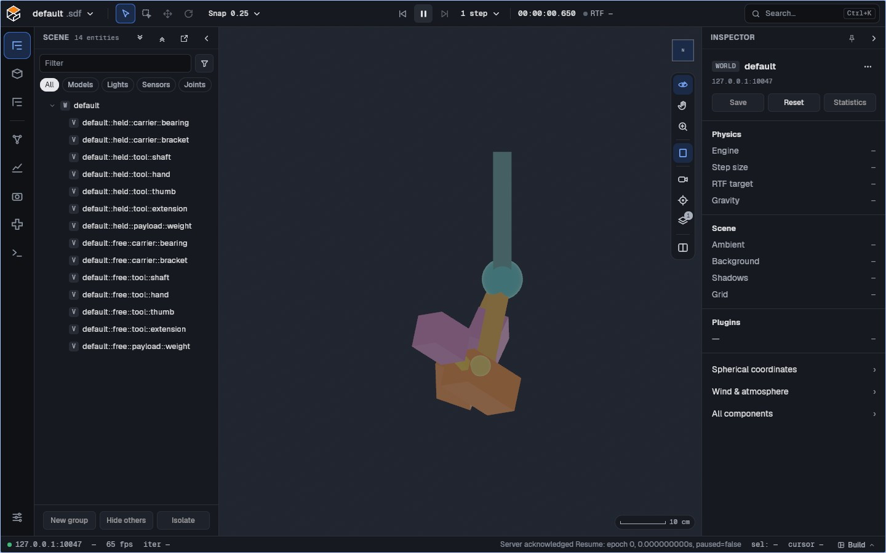

<!-- Copyright (C) 2026 Open Source Robotics Foundation -->
<!-- SPDX-License-Identifier: Apache-2.0 -->

# Where the motor’s work goes

For a 3 kg wrist turning against gravity, the energy supplied by the actuator and by an external shove should equal the increase in kinetic and gravitational potential energy. A separate check compares angular momentum about the fixed bearing with the time integral of the applied moments, including gravity. Each check used the committed state of the native physics solver. The controller still read its encoder and chose one command every millisecond at all three physics rates.

| Native steps per actuator tick | Disturbed feedback wrist, peak energy discrepancy | Peak angular impulse discrepancy | Undisturbed full-inertia wrist, peak energy discrepancy |
|---:|---:|---:|---:|
| 1 | 2.071 mJ | 0.1731 mN·m·s | 0.0987 mJ |
| 2 | 1.036 mJ | 0.0869 mN·m·s | 0.0500 mJ |
| 4 | 0.517 mJ | 0.0435 mN·m·s | 0.0252 mJ |

The new read-only query takes a loaded joint ID and a world-space reference point. It sums each descendant’s actual linear momentum, spin, orbital angular momentum and kinetic energy. A native test used two moving links with different angular velocities and excluded a fast-moving sibling. Shifting the reference point changed angular momentum by the predicted cross product and preserved kinetic energy. A parked 2 kg wrist retained its measured state while a torque was queued and acquired energy on the first resumed solve.

In the robot experiment, gravitational potential used an independent calculation from the authored link masses and their public poses. Motor and disturbance work used the signed joint rotation in each actuator interval. The angular impulse calculation used the held applied torque and the trapezoidal gravity moment at the two ends. The bearing and its carrier were fixed. The small residuals include both solver discretization and the sampling of work and gravity. All six trials repeated after reset. Both original 1 ms recordings retained identical frame bytes. [Raw comparisons](wrist-work-balance.json) · [Fine wrist in gz-web-rs](http://127.0.0.1:8082/?backend=primitive&ui=full&quality=low&replay=1&lifecycle=1&url=ws%3A%2F%2F127.0.0.1%3A10047%2F) · [Original 1 ms wrist](http://127.0.0.1:8082/?backend=primitive&ui=full&quality=low&replay=1&lifecycle=1&url=ws%3A%2F%2F127.0.0.1%3A10042%2F) · [Portable fine recording](wrist-work-balance.tar.xz)

All three native joint regressions, three scene regressions and eight robot-example tests passed. Changed executable line/region coverage was 31/31 and 57/57 in native physics, 9/9 and 7/7 in multifidelity, 18/18 and 26/27 in scene, and 70/70 and 152/155 in the CLI example. The browser verified all 2,814 displayed poses in the 201-frame fine recording.



Run from the physics checkout using a fresh recording path. Select 1, 2 or 4 native steps and use either the undisturbed acceleration or the disturbed feedback experiment.

```sh
RUSTC_WRAPPER= cargo run --locked --release --no-default-features -p gz-sim-cli --example gravity_wrist -- --stabilize --physics-substeps 4 wrist-work
RUSTC_WRAPPER= cargo run --locked --release --no-default-features -p gz-sim-cli --bin gz-sim-rs -- --server --replay --web-viewer 10047 wrist-work/replay
```
